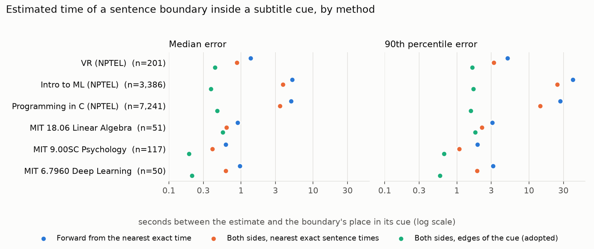

# Preprocessing (stage 0a)

Stage 0a turns a lecture's subtitle file (SRT) into numbered sentences with times. Every later stage works with
these sentences: the segmenter reads them, segments are runs of them, and segment times come from theirs.

**In short**

- Sentences are split by a small rule-based splitter that trusts the subtitles' punctuation. On the six dataset
  courses it finds 94–99.7% of pySBD's boundaries. Where the two disagree, ours is right in the samples checked.
- The splitter handles the conventions of the MIT captions (speaker labels, sound tags, licence notice) and lecture
  names like `24b` and `tut_1`. It leaves the VR course's output byte-identical.
- A sentence gets an exact time only where it starts or ends at a subtitle cue's edge. Where a segment boundary falls
  inside a cue, its time is estimated from the cue's edges and the course's speaking rate. That estimate is
  within 0.2–0.6 s of the boundary's place in its cue at the median, in every course.

## 1. Input and output

| | |
|---|---|
| Input | `input/<course>/input/subs/**/<stem>.srt`: human-written subtitles (the punctuation is trusted) |
| Sentences | `stage_0a_preprocess/<stem>.json`: `{"7/0": "Hello, welcome to …", "7/1": …}` |
| Times | `stage_0a_preprocess/times/<stem>.json`: `{"7/0": {"start": 24.297, "end": 31.884}, …}` |
| Speaking rate | `stage_0a_preprocess/times/meta.json`: median words per minute over all cues of the course |
| Cue timeline | `stage_0a_preprocess/times/cues/<stem>.json`: each cue's start, end and word count |

Sentence IDs are `<lecture key>/<i>`, with `i` from 0 within the lecture. The key is the lecture's name from its file:
`lec_7.srt` → `7`, `lec_24b.srt` → `24b` (MIT 18.06's quiz review), `tutorials/tut_1.srt` → `tut_1`. Lectures sort by
number (24 before 24b), then tutorials.

## 2. Sentence splitting

All cue text of a lecture is joined into one stream and split at sentence ends. A sentence that runs across cues stays
whole, and a cue that holds several sentences is split.

**The rule.** A sentence ends at `.`, `?` or `!` (with any closing quote or bracket), followed by a space and then a
capital letter, a digit or an opening quote. A few abbreviations are not ends: `Dr.`, `Prof.`, `Mr.`, `e.g.`, `i.e.`,
`vs.`, `Fig.`, `Eq.`. The rule is case-sensitive, so `MR.` (Mixed Reality) does end a sentence.

**A lowercase word after a full stop does not start a sentence.** The case is common and ambiguous. In the VR course
(286 times) the full stop is the mistake: "…technologies. which, …". In MIT 18.06 the missing capital is: "OK. let's
…". Not splitting is safe for both: at worst two sentences stay one.

**Compared with pySBD.** pySBD (a rule-based library splitter) was run on the same cleaned text:

| Course | Ours | pySBD | Both | Only ours | Only pySBD |
|---|--:|--:|--:|--:|--:|
| VR (NPTEL) | 11,893 | 12,139 | 11,806 | 87 | 333 |
| Intro to ML (NPTEL) | 5,799 | 5,977 | 5,666 | 133 | 311 |
| Programming in C (NPTEL) | 9,180 | 9,103 | 8,570 | 610 | 533 |
| MIT 18.06 Linear Algebra | 15,951 | 9,678 | 9,372 | 6,579 | 306 |
| MIT 9.00SC Psychology | 19,786 | 15,950 | 15,904 | 3,882 | 46 |
| MIT 6.7960 Deep Learning | 18,725 | 14,289 | 14,116 | 4,609 | 173 |

(Sentence counts before stage 0a drops the licence notice, which accounts for 72 sentences in 9.00SC.)

- **Where only ours splits, the sentence ends are real.** pySBD misses them, mostly around the MIT captions'
  `--` dashes: "…Why should -- no complaint about that. ‖ The trouble is the second direction…".
- **Where only pySBD splits, the splits are wrong.** They fall mid-sentence before a number or variable ("…this is the
  result is n by ‖ n."), or before a lowercase continuation ("…a body part. ‖ by pressing a button.").
- **Decision:** keep the rule-based splitter.

**Limit: Intro to ML has few full stops.** Its subtitles have few sentence-final marks, so its sentences are long: a
median of 32 words and up to 476. Other courses have medians of 9–17 words. No splitting rule can fix this. It would
need a punctuation model.

## 3. Caption conventions

The MIT captions carry conventions that are not lecture speech. Each is handled in a way that changes nothing for a
course without it:

| Convention | Handling | Found in |
|---|---|---|
| Speaker labels (`PROFESSOR:`, `AUDIENCE:`, `PHILLIP ISOLA:`, `A. STRANG:`) | A speaker turn always starts a new sentence, with the label kept in front. A label is ALL-CAPS words with at least 4 letters, then a colon. That rule excludes the VR course's "VR:". | 9.00SC 535 turns, 6.7960 1,243, 18.06 31 |
| Sound tags (`[LAUGHTER]`, `[CLICKING]`) | Removed; a cue left empty is dropped. `[INAUDIBLE]` is kept, because it stands for words that were said. | 9.00SC 20 removed, 6.7960 109 |
| OCW licence notice ("The following content is provided under a Creative Commons license…") | Its sentences are dropped. | every 9.00SC lecture (24) |

## 4. Times

A cue has a start and an end, so a sentence can only be timed exactly where it starts or ends at a cue's edge. A
boundary inside a cue has no time of its own, and stage 0a leaves it `null`. How often that happens depends on how a
course's captions are cut:

| Course | Sentence starts inside a cue | Median cue length at those boundaries |
|---|--:|--:|
| VR (NPTEL) | 201 of 11,830 (1.7%) | 11.2 s |
| Intro to ML (NPTEL) | 3,386 of 5,713 (59.3%) | 7.0 s |
| Programming in C (NPTEL) | 7,241 of 9,119 (79.4%) | 9.4 s |
| MIT 18.06 Linear Algebra | 51 of 15,916 (0.3%) | 5.0 s |
| MIT 9.00SC Psychology | 117 of 19,690 (0.6%) | 3.1 s |
| MIT 6.7960 Deep Learning | 50 of 18,701 (0.3%) | 3.6 s |

The VR and MIT captions break mostly at sentence ends. Programming in C's and Intro to ML's captions are lines of
fixed length that cut sentences anywhere.

## 5. Timing a segment boundary inside a cue

Sentences can stay `null`, but a segment cannot: a player needs its start and end. Only segment boundaries are
estimated, in stage 1b once the segmentation is final. The segment map marks the estimate: `"estimated": ["start"]`.

The estimate uses the course's **median speaking rate**, words per minute over all its cues (VR: 143; across the
six courses 122–191). It went through three versions:

1. **Forward from the nearest exact time.** Start from the nearest earlier sentence start that is exact, then add the
   words spoken up to the boundary at the median rate. This drifts when that time is far back, as with a sentence that
   began in an earlier cue.
2. **Both sides, nearest exact sentence times.** Average the forward estimate and a backward one, counted from the
   nearest later exact sentence end. Errors in the two directions largely cancel. This was good enough for VR and
   MIT. But where cues cut sentences anywhere, the nearest exact times can be minutes apart, and the estimate
   drifts by up to 2.5 minutes.
3. **Both sides, edges of the cue (adopted).** Stage 0a saves each lecture's cue timeline: each cue's start, end and
   word count. The boundary is located by word count in the cue it falls in. Then the forward estimate (from the
   cue's start) and the backward estimate (from the cue's end) are averaged and kept inside the cue. The anchors are
   never more than one cue away.

**Worked example (VR lecture 57, sentence 206).** The boundary falls 4 words into a 33-word cue that runs from
2129.808 s to 2146.991 s.

- Forward: 2129.808 + 4 / 143 × 60 = 2131.49 s
- Backward: 2146.991 − 29 / 143 × 60 = 2134.82 s
- Estimate: the mean, **2133.16 s**



| Course | Forward (median / p90 / max) | Both sides, sentences | Both sides, cue (adopted) |
|---|---|---|---|
| VR (NPTEL) | 1.4 / 5.1 / 14.4 s | 0.9 / 3.3 / 7.4 s | **0.4 / 1.6 / 5.8 s** |
| Intro to ML (NPTEL) | 5.1 / 40.4 / 301.7 s | 3.8 / 24.8 / 157.6 s | **0.4 / 1.7 / 45.0 s** |
| Programming in C (NPTEL) | 5.0 / 27.3 / 264.4 s | 3.5 / 14.2 / 132.9 s | **0.5 / 1.6 / 12.4 s** |
| MIT 18.06 Linear Algebra | 0.9 / 3.1 / 14.7 s | 0.6 / 2.2 / 7.4 s | **0.6 / 1.8 / 5.1 s** |
| MIT 9.00SC Psychology | 0.6 / 1.9 / 4.9 s | 0.4 / 1.2 / 2.5 s | **0.2 / 0.7 / 1.1 s** |
| MIT 6.7960 Deep Learning | 1.0 / 3.6 / 8.5 s | 0.6 / 1.9 / 4.1 s | **0.2 / 0.7 / 1.9 s** |

**What the error is measured against.** The reference is the boundary's character position within its cue, as a
fraction of the cue's duration. That reference is itself an estimate: exact times would need forced alignment with
the audio. It shows how far an estimate drifts away from the cue the boundary is in. Within one cue, any method is off
by at most the cue's length. The largest error left (45 s, Intro to ML) is in an unusually long cue.

**Decision:** the cue-edge estimate. It is accurate enough for playback, needs no audio, and adds one small file per
lecture.

**In the VR course** the verified segmentation (391 segments) has 2 cuts inside a cue, in lectures 42 and 57. Their
4 segments carry estimated times.

## 6. Course summary

| Course | Lectures | Sentences | Words per sentence (median / p90 / max) | Speaking rate (wpm) |
|---|--:|--:|---|--:|
| VR (NPTEL) | 63 | 11,893 | 15 / 31 / 124 | 143 |
| Intro to ML (NPTEL) | 86 | 5,799 | 32 / 101 / 476 | 164 |
| Programming in C (NPTEL) | 61 | 9,180 | 17 / 42 / 129 | 122 |
| MIT 18.06 Linear Algebra | 35 | 15,951 | 9 / 25 / 96 | 130 |
| MIT 9.00SC Psychology | 24 | 19,714 | 10 / 24 / 103 | 191 |
| MIT 6.7960 Deep Learning | 24 | 18,725 | 12 / 30 / 120 | 177 |

Only VR has been run through the pipeline. The other five were preprocessed for these measurements only, without
saving outputs. To run one: place its subtitles under `input/<course>/input/`, write its `course.json` (outline and
syllabus), and run the stages.

## 7. Open points

- **Intro to ML's sparse punctuation** gives very long sentences (section 2). That makes its segment boundaries coarse
  and its prompts harder to read. A punctuation-restoration model would fix it, if the course is used.
- **Exact times would need forced alignment** with the audio (wav2vec2 or whisperX). It is not needed for playback at
  the current accuracy.

## Reproduce

```bash
cd pipeline
python ../analysis/preprocessing/scripts/measure.py     # data/: course_stats, boundary_time_errors, pysbd_comparison
python ../analysis/preprocessing/scripts/figures.py     # figures/boundary_time_error.png
```
