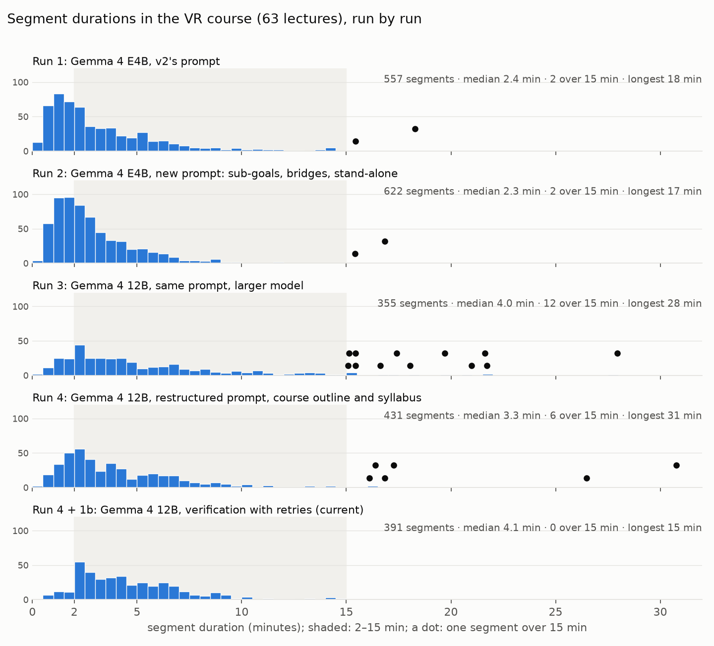
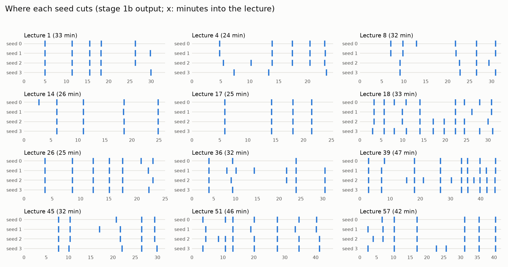
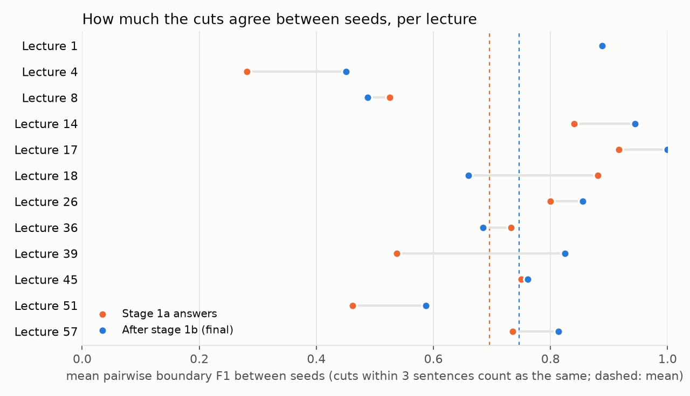

# Segmentation (stages 1a–1c)

Segmentation splits each lecture into segments that a learner can watch on their own. Every segment is the part of
the lecture in which the learner achieves one sub-goal. This report covers how the current design was reached (runs
1–4 on the VR course), the pipeline as it stands, how much its output varies from run to run, and what follows for
the next stages.

**In short**

- **The current pipeline segments the VR course (63 lectures) into 391 segments.** It uses Gemma 4 12B, a structured
  prompt, and a verification stage that retries in code. Every lecture passes, no segment is over 15 minutes, and
  only one segment is flagged as looking too small.
- **Two changes mattered most.** One was a model large enough to follow the rules (4B → 12B). The other was rules it
  cannot over-apply: the "stand-alone" rule had to forbid only real dependencies, not connectives.
- **Verification removes the extremes and halves the run-to-run spread in segment counts.** It makes few other
  changes: between the model's first answers and the verified segments, boundary F1 is 0.77, about the same as
  between two seeds.
- **Run to run, about three quarters of the cuts reproduce** (boundary F1 0.75 between seeds). The disagreement sits
  in lectures that enumerate items, where the right granularity is a judgement call. Downstream stages should not
  treat a segment boundary as exact.

## 1. What a segment is

These definitions are given to the model in the segmentation prompt (`pipeline/prompts/segmentation.txt`):

- **Sub-goal.** A step toward the *course's* goals that the lecture achieves: something the learner can do after
  that part of the lecture and could not do before. Taken in order, the sub-goals are the learner's task list for the
  lecture. A sub-goal is a whole step: the examples, details and digressions used to reach it belong to it.
- **Segment.** The run of consecutive sentences in which one sub-goal is achieved.
- **Not sub-goals.** The greeting, the recap of the previous lecture, the outline, the closing summary and the
  goodbye. They are about the lecture itself, not the course's goals. Opening remarks belong to the first segment.
  Closing remarks may be the last segment on their own.
- **Where to cut.** Where a sub-goal is closed. A bridge ("Now let us see how…") starts the next segment. Never cut
  inside an explanation, a derivation or a worked example.
- **Stand-alone.** A segment must not depend on something that only the previous segment explains and that it never
  names or restates. Connectives ("So, given this background, …") are not dependencies.

## 2. How the design was reached: runs 1–4

Each run segmented all 63 lectures of the VR course. Earlier pipelines (v1, v2) had their own segmentations. Those
were not reused, but they set the problem: v2's large run (Qwen 27B) had 36 parts over 10 minutes and one of 28
minutes (lecture 51, a whole worked problem in one part).

| Run | Model | What changed | Why |
|---|---|---|---|
| 1 | Gemma 4 E4B (local) | v2's prompt, unchanged | Baseline |
| 2 | Gemma 4 E4B | New prompt: segments defined by sub-goals; bridges go to the next segment; segments stand alone; opening and closing remarks are not sub-goals | v2's segments were cut at bridges and ran long |
| 3 | Gemma 4 12B | Same prompt, larger model | The 4B followed the finer rules in only about half the lectures |
| 4 | Gemma 4 12B | Prompt restructured: task first; course outline and syllabus; sub-goals defined by the course's goals; stand-alone rule limited to real dependencies; list rule dropped | The 12B over-applied "stand-alone" and merged segments over connectives |
| 4 + 1b | Gemma 4 12B | Verification stage: structural checks, plus a size check (segments under 2 or over 15 minutes are sent back), with retries | Run 4 still chose its granularity inconsistently, with segments of 31 minutes and of 30 seconds |



| | Run 1 | Run 2 | Run 3 | Run 4 | Run 4 + 1b |
|---|--:|--:|--:|--:|--:|
| Segments | 557 | 622 | 355 | 431 | **391** |
| Per lecture (min–max) | 4–16 | 5–25 | 2–17 | 2–14 | 2–10 |
| Median duration | 2.4 min | 2.3 min | 4.0 min | 3.3 min | **4.1 min** |
| Under 2 min | 234 | 253 | 62 | 105 | **30** |
| Over 15 min | 2 | 2 | 12 | 6 | **0** |
| Longest | 18.3 min | 16.8 min | 27.9 min | 30.8 min | **14.6 min** |
| First segment under 2 min | 41 | 30 | 6 | 14 | **0** |
| Last segment under 2 min (mostly the closing summary) | 50 | 36 | 18 | 30 | 29 |

Durations are measured the same way for every run: from each segment's first and last sentence, with the pipeline's
timing.

**What each run showed**

- **Run 1 → 2: the 4B model cannot follow the finer rules.** The new definitions cut the long segments (over 10
  minutes: 20 → 7). But the 4B labelled greetings and goodbyes as sub-goals ("Conclude the lecture…") and cut the
  items of a list apart (one 41 s and one 11 s segment), so it cut finer overall.
- **Run 2 → 3: the 12B follows the rules literally.** It folded opening remarks into the first segment (first
  segment under 2 min: 30 → 6) and rarely ended a segment on a bridge. But its thinking on lecture 51 shows the
  stand-alone rule set off chained merges: "'So, given this background…' … Therefore, Segment 2 and 3 must be
  merged." Lecture 51 went back to a 28-minute segment.
- **Run 3 → 4: rules it cannot over-apply.** Stand-alone now forbids only real dependencies and says outright that
  connectives are not one. The list rule ("items of a list make one sub-goal") was too specific and seemed to make the
  model think about splitting lists, so it was replaced by "a sub-goal is a whole step toward the course's goals".
  Lecture 51 became 8 steps, the longest 7.5 minutes. Granularity was still chosen differently from lecture to
  lecture: lecture 39 had a 31-minute "selection techniques" segment, while lecture 8 gave each of six qualities of
  immersion its own 1–2 minute segment.
- **Run 4 → 4 + 1b: verification.** The size check flags segments; the model is told only which ones "look too small"
  or "look too big" (section 3). On 37 lectures, 28 needed one retry and 9 two. Most of the changes follow the
  lecturer's own structure: lecture 39 became the lecturer's categories of selection and manipulation; lecture 4 the
  checklist and its three worked examples. Some changes serve size instead, such as Shneiderman's eight rules split
  into "first four" and "final four" (lecture 38).

**Two retry wordings were tested** on 8 lectures, starting from run 4's answers.

- **"These segments look too small / too big; check them against the instructions."** Out-of-range segments went from
  24 to 1, but some merges were grab-bags made for size ("3D structure tracking and inertial tracking").
- **The same, plus a direction:** "see whether small ones together make a more meaningful sub-goal; whether big ones
  divide into more manageable sub-goals." 3 segments were left out of range, and the changes followed the lecture more
  closely: lecture 8 kept presence apart from immersion; lecture 18 split vision-based tracking into the lecturer's
  own parts.
- **Adopted: the second wording.**

## 3. The pipeline as it stands

```
0a  preprocess     SRT → numbered sentences, times, cue timeline           (see analysis/preprocessing/report.md)
1a  segmentation   one model call per lecture → its segments: [{"start": sentence, "subgoal": "Explain …"}]
1b  verification   structural checks ──fail──► structural retry ──► new answer ──► structural checks …
                        │ pass
                   logical checks ───flagged──► logical retry ───► new answer ──► structural checks …
                        │ pass, or retries used up
                   keep the valid answer with the fewest flagged segments → segment maps with times
1c  segment texts  one text file per segment
```

- **Prompt (1a).** The task; the course's outline and syllabus (from `course.json`, written by hand from the course's
  syllabus); the lecture's title; the definitions of section 1; the numbered transcript. Everything before the
  transcript is the same for every lecture of a course, so the engine can cache it.
- **Structural checks (hard).** The answer is a non-empty list; the first segment starts at sentence 1; starts are
  within the lecture and strictly increase. As sets of sentences, the segments are exhaustive, mutually exclusive,
  contiguous and ordered, and non-empty. An answer that fails is never kept.
- **Logical checks (soft).** A segment under 2 minutes (except the last) or over 15 minutes is flagged. The bounds are
  a heuristic, not a rule anyone can defend, so the model is told neither the bounds nor any durations, and it may
  keep a segment it judges right.
- **Retries.** Up to 2 structural retries for each answer that fails, and up to 2 logical retries per lecture. The
  server keeps no state, so 1b re-sends the conversation: the 1a prompt, the model's last answer, and the retry
  prompt (all from `prompts/*.txt`). The model's thinking is not sent back. Instead, every retry answer carries a
  short `reasoning` field ("Segment 2 was combined with … because …; Segment 1 was kept as is because …"). The next
  retry repeats it, so the model builds on its last attempt instead of starting over.
- **Times.** A segment starts at its first sentence's start and ends at its last sentence's end. A cut inside a
  subtitle cue gets an estimated time (cue edges and the course's speaking rate; see the preprocessing report), marked
  `"estimated"` in the segment map. VR has 2 such cuts, in lectures 42 and 57.
- **Record.** `stage_1b_verify_segments/retry/` keeps every attempt for each lecture: the retry prompt sent, the answer,
  its reasoning, the model's thinking, the problems found and the segment lengths. `report.json` sums up each lecture.

**Result on the VR course (Gemma 4 12B, local, about 40 min for 1a and 40 min for 1b):**

- **Outcome:** 63/63 lectures pass and 391 segments, median 4.1 minutes.
- **Retries:** no structural retries were needed; 37 lectures were retried for size.
- **Kept answer:** the first answer in 26 lectures (nothing flagged), the first retry in 29, and the second in 8.
- **Still flagged:** one segment, which the model kept: "Describe locomotion modification techniques for mitigation",
  1 min 43 s.

## 4. Run-to-run variability

**Question.** The model samples at temperature 1.0. How much of the segmentation is the lecture, and how much is the
draw?

**Method.** The full pipeline (1a and 1b with retries) was run on 12 lectures with three more seeds. Lectures 1, 4,
8, 14, 17, 18, 26, 36, 39, 45, 51 and 57 cover short and long lectures, list-heavy ones, a worked problem and a case
study. Seed 0 is the pipeline's own output. Everything else was fixed: prompt, model, configuration. Each pair of
seeds was compared on each lecture with two measures:

- **Boundary F1.** A cut counts as reproduced if the other seed cuts within 3 sentences of it (1 = the same cuts).
- **WindowDiff** (Pevzner & Hearst, 2002), a standard measure for text segmentation (0 = identical).

Both were measured for 1a's first answers and for 1b's final segments.



| Between seeds (12 lectures) | Stage 1a answers | After stage 1b (final) |
|---|--:|--:|
| Boundary F1, mean over lectures | 0.70 | **0.75** |
| WindowDiff, mean over lectures | 0.23 | **0.15** |
| Spread of segment counts per lecture (max − min), mean | 4.3 | **2.2** |
| Segments over 15 min, all seeds | 7 | **0** |
| Segments in all 12 lectures, per seed | | 82 / 84 / 88 / 82 |



**What the seeds show**

- **Most lecture structure reproduces.** In lectures where the lecturer announces clear parts, the seeds cut in the
  same places: lecture 17 (tracking stages, F1 1.00), 14 (0.94), 1 (0.89), 26 (0.86).
- **The disagreement is about granularity, not position.** The least stable lectures enumerate items: lecture 4
  (definitions, then worked examples: 0.45), 8 (six qualities of immersion: 0.49), 51 (the steps of a worked problem:
  0.59), 18 (a list of tracking technologies: 0.66). The seeds agree on the main parts and differ on whether the items
  are one segment or several. In lecture 8 every seed cuts near 23 and 27 minutes, but they differ on how to split the
  first 20.
- **Verification makes the output more consistent.** It halves the spread of segment counts (4.3 → 2.2), lowers
  WindowDiff (0.23 → 0.15), and removes every segment over 15 minutes. Most lectures agree more after it (lecture 39:
  0.54 → 0.83). One agrees less (lecture 18: 0.88 → 0.66), because different seeds merge different small segments.
- **Structural failures are rare, of one kind, and fixed by one retry.** 3 of 48 first answers, and one retry answer,
  began after sentence 1: they left out the opening remarks. One retry fixed each. The same error appeared in run 2.

**What this means for comparing runs.** Between two seeds of the same pipeline, boundary F1 is 0.75. Between
consecutive runs in section 2 (12 sample lectures) it was 0.69 (1 vs 2), 0.57 (2 vs 3) and 0.59 (3 vs 4). Those
prompt and model changes moved the cuts more than chance does. Run 4 against its verified version scores 0.77,
within seed noise: verification moves few cuts, and it mainly fixes the extremes. A future change (another model,
another prompt) should be judged against this noise level, on more than one seed.

## 5. Conclusions

1. **The design is complete and works on the VR course.** All lectures pass, and every segment is between 2 and 15
   minutes except the closing summaries and one segment the model kept. Every retry and its reasoning is on record.
2. **The rules must be ones the model cannot over-apply.** A small model ignores the finer rules. A capable model
   follows them literally, so a rule that sounds harmless ("move the cut back to where the thought begins") can
   restructure a lecture. Each rule needed a precise reading.
3. **A verification loop in code works better than asking for more in the prompt.** Hard checks keep the output
   valid. A soft check, worded without numbers, plus the model's own reasoning, fixes the extremes without forcing
   segments to a length.
4. **Segment boundaries are reproducible at about three quarters.** The rest is granularity in enumerative content,
   where people would disagree too. Downstream stages should tolerate boundaries that move by a segment or so. If a
   stable segmentation is ever needed, a consensus over several seeds is the direct way to get one.
5. **Next.** A larger model (e.g. on the EC2 instance), judged against the seed noise measured here. The other
   courses, which need only a `course.json` each; MIT lectures are 2–5 times longer, which costs speed only.

## 6. A dependency judge (first test)

No check covers the stand-alone rule, so a judge was tried (`pipeline/prompts/segmentation_judge.txt`). It asks one
question per segment: *can a learner who has watched all earlier lectures, but not the earlier part of this lecture,
start here and follow the segment's main point?* The judge sees the course block, the earlier part of the lecture
and the segment. A dependency counts only if the judge names the sentence in this lecture's earlier part that
explains it.

**Test.** 16 segments: the 10 openings that looked most like back-references in the whole course ("the R3 question…",
"It has its own sub-stages…") and 6 controls. Gemma 4 12B, two runs.

- **No false alarms:** no control was flagged in either run.
- **Most suspects were fine.** In 8 of the 10 suspects the "it", "this" or "those" is resolved within a sentence or
  two, and the judge quotes where.
- **Two borderline cases flipped between runs.** One opens with "the R3 question", the other uses notation from
  earlier; both explain their main point themselves.
- **The evidence rule was added after run 1.** Run 1 flagged a reference to an example from the previous lecture,
  which the learner has seen; requiring a sentence in this lecture's earlier part removed that.

**Reading.** Real dependencies appear rare in the current segmentation. A single judge call is not stable on
borderline cases, so a measurement would need temperature 0 or a majority of 3 calls. Feeding the judge into 1b's
retries would risk merging segments over a dangling word.

**Decision (2026-11-11):** the judge is not part of the pipeline. Whether to use it, as a metric or as a check, is
decided after the larger-model runs. Segmentation quality is good enough to build the next stages on.
Test data: `data/judge_test/` (prompt, both runs' verdicts and the judge's thinking).

## Data and reproduction

| Path (under `analysis/segmentation/`) | Content |
|---|---|
| `data/history/` | every run's outputs: runs 1–4, the two retry-wording tests, the first 1b run, the verified run before cue-based times |
| `data/runs/seed_<k>/` | the run-to-run study: stage 1a answers and stage 1b outputs (with retries) per seed; seed 0 is copied from the pipeline |
| `data/history_runs.csv`, `data/run_to_run_pairs.csv`, `data/run_to_run_lectures.csv` | the numbers in this report |
| `scripts/run_to_run.py` | runs the pipeline's stages once per seed into a scratch folder |
| `scripts/analyze.py` | measures everything and draws the figures |

The current segmentation stays in `pipeline/output/nptel_vr/` (stages 1a, 1b, 1c).

```bash
cd pipeline
python ../analysis/segmentation/scripts/run_to_run.py --seeds 1,2,3     # about 15 min per seed on the local GPU
python ../analysis/segmentation/scripts/analyze.py
```
