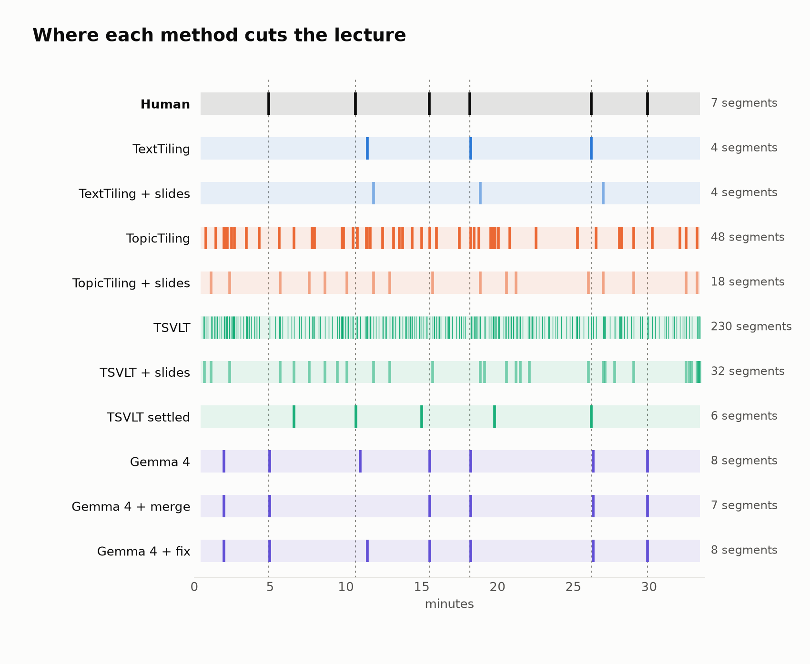
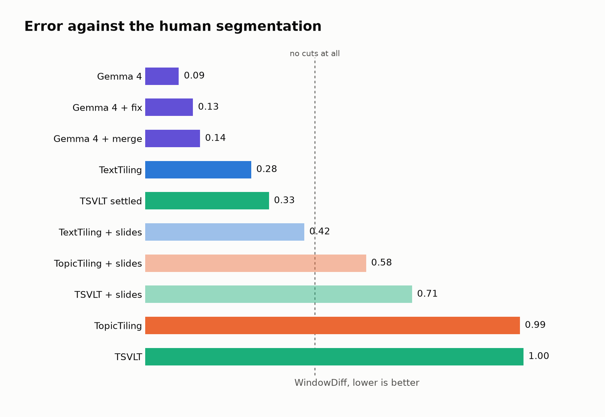
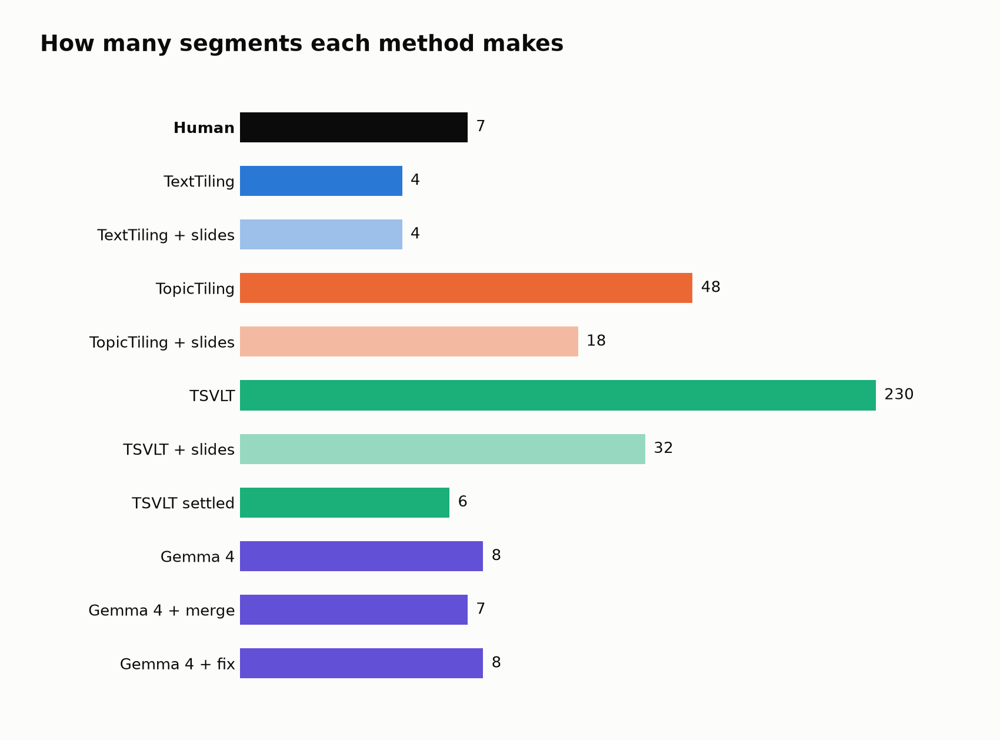
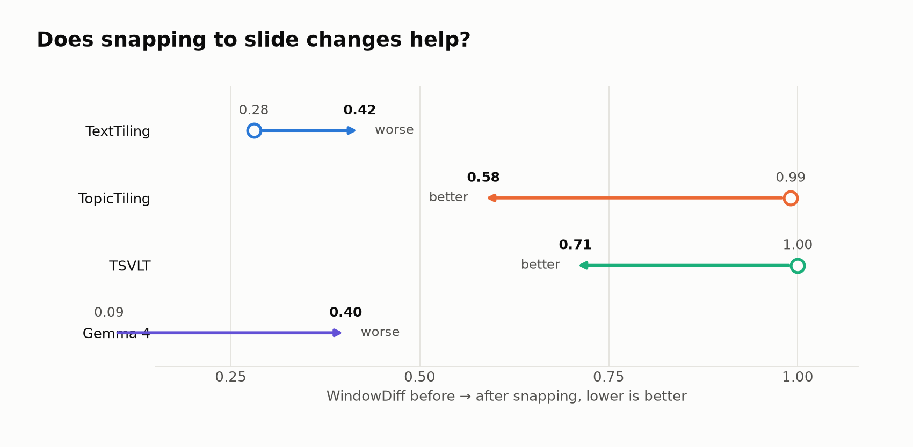
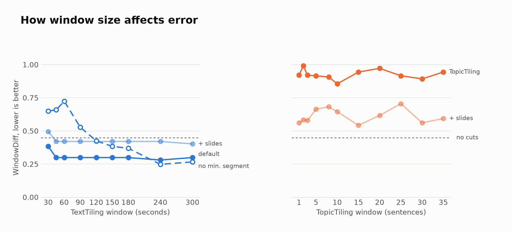
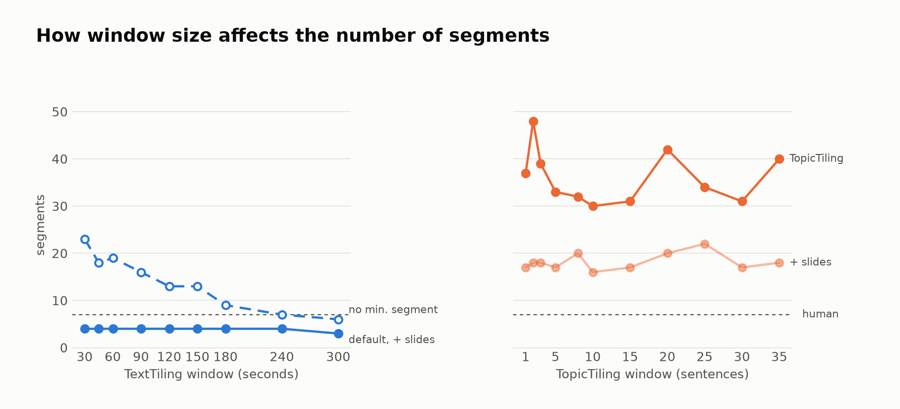

# Segmenting Lecture 1: TextTiling vs TopicTiling vs TSVLT vs Gemma

Lecture: *Foundation for Virtual and Augmented Reality Systems*, Week 1, Lecture 1 (33 min, 230 sentences).
Reference: P01's coarse boundaries from `lec1__P01__both.json` (6 boundaries, 7 segments).
Metric: WindowDiff (WD), lower is better. A WD of 0.45 is what you get with no cuts at all; seven equal slices score 0.36.

## Bottom line

1. **Asking Gemma 4 directly for the boundaries agrees best with the human, by a wide margin** (WD 0.09 at temperature 0). It makes 8 segments against the human's 7 and lands within 30 seconds of all six human boundaries. Sampled runs are less reliable (0.08 to 0.49).
   Adding a validation pass that checks each cut for a "standalone" start does not improve agreement: dropping failed cuts gives WD 0.14, moving them gives 0.13.
2. **TextTiling, the method already in the pipeline, is the best of the classical methods** (WD 0.28). Its cuts are real but it only makes 4 segments against the human's 7.
3. **TSVLT does not work as published.** The repository has no trained weights, does not run without fixes, and once trained with its own code and defaults it cuts after every single sentence (WD 1.00). Its boundary *scores* carry some signal, though: picked with a minimum-segment rule they give a usable 6-segment result (WD 0.33).
4. **TopicTiling over-segments badly** (48 segments, WD 0.99) at every window size.
5. **Snapping forward to slide changes helps the methods that over-segment and hurts the ones that don't.** It rescues TopicTiling and TSVLT only by collapsing their cuts onto the slide track; it makes TextTiling and Gemma much worse, because on this lecture the slide appears 7 to 65 seconds *after* the instructor has started the new topic.
6. **Window size is not the lever for TextTiling.** With the 6-minute minimum segment the output is identical for every window from 45 s to 180 s. The minimum segment is what shapes the result, and it is also why TextTiling can never reach the human's 7 segments: three of the human segments are shorter than 6 minutes.

## 1. Results

Every method runs on the same 230 sentence units (the pipeline's `to_sentences` over the SRT), so boundaries are directly comparable.

| Method | Setting | Segments | WD | Pk | F1 ±30 s | F1 ±60 s |
|---|---|---:|---:|---:|---:|---:|
| Human (P01 coarse) | reference | 7 | | | | |
| **Gemma 4** | single pass, standalone-segments prompt, temperature 0 | 8 | **0.09** | 0.09 | 0.92 | 0.92 |
| Gemma 4 + validation (fix) | failed cuts moved to a concluded point | 8 | 0.13 | 0.13 | 0.77 | 0.92 |
| Gemma 4 + validation (merge) | failed cuts dropped | 7 | 0.14 | 0.14 | 0.83 | 0.83 |
| Gemma 4 + slides | single pass, snapped forward | 8 | 0.40 | 0.40 | 0.15 | 0.62 |
| Gemma 4, first prompt | single pass, original wording | 10 | 0.24 | 0.19 | 0.80 | 0.80 |
| **TextTiling** | W=240 s, min segment 360 s (best window) | 4 | **0.28** | 0.28 | 0.44 | 0.67 |
| TextTiling | W=180 s, min segment 360 s (current default) | 4 | 0.30 | 0.30 | 0.44 | 0.67 |
| TextTiling | W=240 s, no min segment | 7 | 0.25 | 0.25 | 0.33 | 0.67 |
| TextTiling + slides | W=240 s, min segment 360 s | 4 | 0.42 | 0.42 | 0.00 | 0.44 |
| TopicTiling | w=2 sentences | 48 | 0.99 | 0.55 | 0.19 | 0.23 |
| TopicTiling + slides | w=2 sentences | 18 | 0.58 | 0.50 | 0.17 | 0.52 |
| TSVLT | as trained, default settings | 230 | 1.00 | 0.55 | 0.05 | 0.05 |
| TSVLT + slides | as trained, default settings | 32 | 0.71 | 0.52 | 0.11 | 0.32 |
| TSVLT settled | stage-2 scores + min segment 240 s (not a default) | 6 | 0.33 | 0.33 | 0.55 | 0.55 |
| Slide changes alone | every detected slide change is a cut | 26 | 0.70 | 0.52 | 0.13 | 0.39 |
| No cuts | baseline | 1 | 0.45 | 0.45 | | |
| Seven equal slices | baseline | 7 | 0.36 | 0.36 | | |

## 2. TextTiling (embedding-based, current pipeline)

**What works**
- Its three cuts are real topic changes. Two land within 3 seconds of the human's marks (18:13 vs 18:10, 26:11 vs 26:10). The third (11:25) is about 50 seconds after the human's 10:38.
- It is stable: the same three boundaries come out for every window from 45 s to 180 s.
- Apart from Gemma, it is the only method whose default output is better than the "seven equal slices" baseline.

**What doesn't**
- It under-segments: 4 segments against the human's 7. It misses 4:53, 15:30 and 29:53.
- This is structural. With a 360 s minimum segment a 33-minute lecture can hold at most 5 segments, and the human's segments run as short as 160 s.
- Removing the minimum segment gives 7 segments and the best score in the study (WD 0.25 at W=240 s), but two of the seven are junk at the edges: a 28-second "meet the instructor" segment and a 1-second closing segment. With small windows and no minimum it over-segments (up to 23 segments, WD 0.72).

## 3. TopicTiling (LDA, 100 topics)

LDA was trained on the other 47 lecture transcripts of the course (lecture 1 held out; 412 chunks, about 65,000 tokens), using the usual TopicTiling settings (alpha 0.5, beta 0.01, 500 Gibbs iterations, most-frequent-topic assignment, threshold at mean minus half a standard deviation). The window of 2 sentences is my choice of headline setting.

**What works**
- It fires near most human boundaries: the average human boundary has a TopicTiling cut within 14 seconds.

**What doesn't**
- That closeness is bought with 48 segments. Many are 3 to 15 seconds long.
- No window fixes it. Swept over 11 windows from 1 to 35 sentences (about 9 seconds to 5 minutes of speech, the same span as the TextTiling sweep), it produces 30 to 48 segments and WD stays between 0.86 and 0.99.
- Two causes. At small windows, spoken sentences carry about 6 content words each, so the topic vectors are nearly empty and the similarity curve is noise. At large windows the curve does get smooth (the typical step between neighbouring gaps falls from 0.2 to 0.01), but it still has about 50 small dips, and TopicTiling's rule keeps every dip deeper than the mean minus half a standard deviation. That threshold is relative, so it keeps roughly two thirds of the dips however shallow they are. TextTiling in the pipeline avoids this with smoothing and a minimum segment; TopicTiling has neither.

## 4. TSVLT

### What the repository actually contains
The paper says the repository contains everything needed to reproduce the results. It does not contain a trained model, and it does not contain the dataset: only 5 toy transcripts of 22 to 28 sentences (125 sentences, 18 boundaries). So training is unavoidable, and only on those 5 samples. Several things had to be patched before any of it would run:

| Problem in the shipped code | Effect |
|---|---|
| Asks for the tokenizer `microsoft/all-mpnet-base-v2`, which does not exist | `evaluate.py` and `train_all.py` both crash on start |
| Window partitioning appends a list and then pops from it | Crashes on any transcript longer than 2,048 tokens, i.e. any real lecture |
| Contrastive (InfoNCE) loss has a tensor shape error | Crashes; it is also fed detached features, so it could not affect training even when fixed. The "contrastive learning" in the title does nothing in this code |
| PPO buffer stores log-probabilities with their graph and the wrong shape | The policy update crashes |
| README lists scripts, modules, a notebook and tests that are not in the repo | |
| Sample annotations disagree with each other | `SLTB-NPTEL-001_boundaries.txt` says 6, 13, 19; the metadata CSV says 7, 14, 21, 26 for the same transcript |

All fixes are applied from `run_compare.py` without editing the TSVLT repo, and each is commented there.

### What it produces, with default hyperparameters (5 random seeds)

| After stage | Boundaries on the 230-sentence lecture |
|---|---|
| 2, multi-scale CNN | 0 on every seed. 15 epochs is not enough; the highest probability is 0.47, under the 0.5 threshold. It finds none of its own training boundaries either |
| 3, graph refinement | 188 to 214. The step *adds* a coherence score (close to 1 for neighbouring sentences) to the probability, so nearly everything crosses 0.5. The graph network's weights are random; nothing trains them |
| 4, PPO policy (final) | 229 on four seeds (a cut after every sentence), 0 on the fifth |

### Why so many segments
You noticed TSVLT has cuts close to the human labels. It does, but only because it has a cut after every sentence: the average human boundary is 2 seconds from a TSVLT cut, and so is every other point in the lecture. Precision is 3%.

The cause is the stage-4 reward. It needs no labels, and it rates a one-sentence segment as perfectly coherent. Scored on this lecture:

| Segmentation | Coherence | Reward (code) | Reward (paper's length term, μ = 40 sentences) |
|---|---:|---:|---:|
| Every sentence its own segment | 1.00 | **+0.55** | **+0.44** |
| A cut every 6 sentences | 0.35 | +0.26 | +0.08 |
| Human coarse segmentation | 0.32 | −0.01 | +0.06 |
| No cuts | 0.21 | −0.02 | −0.02 |

The policy is doing exactly what it is trained to do. The length term that should stop this has a weight of only 0.1 against 0.4 for coherence.

### What the paper says about it
- The length reward in the paper is −|L − μ| / μ, with μ the average segment length in the training data. The code instead hard-codes an ideal of **6 sentences**, with a comment that reads "6 boundaries per transcript": a count of boundaries used as a segment length. With the paper's own dataset figures (about 1 million words, 210 transcripts, 6 segments each) μ should be several dozen sentences.
- Even with the paper's formula and a realistic μ, cutting everywhere still wins (last column above).
- The paper says weak boundaries "may be conditioned on post-processing rules" and shows final boundaries "after post-processing", but never states the rules, and the code has none.
- The paper describes stage 4 as a refinement of stage 3's candidates, not a detector. In the code it is warm-started with 5 gradient steps and then trained freely on the reward, so nothing ties it to stage 3.
- The paper states both that the reward uses no gold boundaries and that the progression reward "rewards boundaries that align with gold-standard thematic transitions".

### Can it be made to settle?
Yes, partly, by replacing the threshold with a rule that limits segment length. I kept TSVLT's per-sentence boundary scores and chose boundaries with the pipeline's existing selector (best-scoring set subject to a minimum segment):

| Scores from | Min segment | Segments | WD |
|---|---|---:|---:|
| Stage 2, default training | 120 / 240 / 360 s | 8 / 4–5 / 3 | 0.55 / 0.58 / 0.58 |
| Stage 2, trained 300 epochs | 120 s | 12 | 0.41 |
| **Stage 2, trained 300 epochs** | **240 s** | **6** | **0.33** |
| Stage 2, trained 300 epochs | 360 s | 4 | 0.51 |

The best one cuts at 6:34, 10:39, 15:00, 19:47 and 26:11. Two of those are within 1 second of the human (10:38, 26:10), and 10:38 is a boundary TextTiling misses. So the CNN, trained to convergence on the toy samples, has learned something real, most likely explicit transition phrasing ("now let us move on to…").

Caveats: this is not the published method (longer training, different boundary selection, stages 3 and 4 dropped), and I picked the 240 s setting after seeing the scores. It is still worse than TextTiling.

## 5. Slide snapping (forward only)

Slide changes were detected from the video: frame differences at 1 frame per second (94 cuts) plus OCR every 2 seconds to tell a new slide from the camera cutting back to the speaker. A slide change is the first appearance of a slide whose text differs from the last slide shown. That gives 30 slide changes. Each boundary is then moved **forward** to the first sentence starting at or after the next slide change, never backward; boundaries landing on the same change merge.

| Method | Segments before → after | WD before → after | Mean shift |
|---|---|---|---|
| TextTiling (W=240 s) | 4 → 4 | 0.28 → 0.42 | 36 s |
| TopicTiling (w=2) | 48 → 18 | 0.99 → 0.58 | 66 s |
| TSVLT | 230 → 32 | 1.00 → 0.71 | 74 s |
| Gemma 4 | 8 → 8 | 0.09 → 0.40 | 51 s |

**What works:** it merges clusters of spurious cuts, which is the whole gain for TopicTiling and TSVLT.

**What doesn't:**
- It moves good boundaries off target. TextTiling's two near-perfect cuts (18:13, 26:11) get pushed to 18:52 and 26:57, and its F1 at ±30 s drops from 0.44 to 0. Gemma's F1 at ±30 s drops from 0.92 to 0.15, and it gets worse on every one of its five runs.
- The reason is timing. The instructor announces the next topic while the old slide (or his face) is still on screen. The next slide change comes 44, 65, 7, 36 and 22 seconds after the first five human boundaries; for the sixth (29:53) there is no slide change for over two minutes.
- TSVLT + slides is not a TSVLT result. With a cut at every sentence, forward snapping just returns the slide track: 0.71 against 0.70 for slide changes alone.
- Slide changes on their own are a poor segmenter (26 segments, WD 0.70): most slide changes are steps within a topic.

## 6. Window size

- **TextTiling, default minimum segment:** flat. WD 0.30 for 45 s to 180 s, 0.28 at 240 s, 0.30 at 300 s (where it drops to 3 segments). Only 30 s is clearly worse (0.38).
- **TextTiling, no minimum segment:** the window matters a lot. Segments fall from 23 (30 s) to 6 (300 s) and WD from 0.72 to 0.25. Large windows do the smoothing the minimum segment otherwise does.
- **TextTiling + slides:** flat and uniformly worse (0.42).
- **TopicTiling:** no useful window anywhere from 1 to 35 sentences. 30 to 48 segments and WD 0.86 to 0.99 throughout; with slides 0.54 to 0.71. Unlike TextTiling, a bigger window does not reduce the number of segments.

## 7. Gemma 4 as a segmenter

The same local model the pipeline uses for labeling (gemma-4-E4B-it, Q8, llama.cpp) is given the whole transcript as numbered sentences and asked for the sentence numbers that start a new segment. It is not told how many segments to make. One segmentation takes about a minute.

### 7.1 Single pass

The prompt went through three versions:

| Prompt | Segments | WD | What happened |
|---|---:|---:|---|
| First: "find the apt boundaries where the instructor completes an instructional goal or a topic" | 10 | 0.24 | All six human boundaries found, but the introduction is split mid-thought (a cut at 3:37 lands before "That is, of course, one very natural question…") |
| Second: the same plus a list of rules and banned opening words ("that is", "so", "as I said"…) | 14 | 0.45 | Worse. More fragments, and the 3:37 cut is still there |
| **Third (current): "each segment must stand alone… cut only at a logically concluded point… a question and its discussion belong in the same segment… prefer fewer, complete segments"** | **8** | **0.09** | The 3:37 and 22:15 cuts are gone |

The current prompt in full:

> Split the lecture into segments. Find the apt boundaries: the points where the instructor has completed an instructional goal or a topic and moves on to the next one.
>
> Each segment must stand alone: a learner who starts watching at the first sentence of any segment, without having seen what came before, must be able to follow it. Cut only at a logically concluded point, after the instructor has finished the thought, never while he is in the middle of explaining something. A question and the discussion of that question belong in the same segment. Do not cut at every change of example or sentence-level aside; prefer fewer, complete segments over many fragments.

Its cuts at temperature 0, against the human's:

| Gemma | Human | Opening sentence of the new segment |
|---|---|---|
| 1:56 | (none) | "What do these terms refer to?" |
| 4:58 | 4:53 | "Now, before going on to talk about the other things related to addressing these questions…" |
| 10:56 | 10:38 | "As I said at the beginning, when I use the term VR or virtual reality…" |
| 15:31 | 15:30 | "But before that, let me draw your attention to one more important concept…" |
| 18:13 | 18:10 | "Now, let us try to seek the answer to why the interest." |
| 26:18 | 26:10 | "And before we go to the next lecture, let me just briefly talk about this course…" |
| 29:53 | 29:53 | "So with that, we have come to the conclusion of this first lecture." |

**What works**
- Six of its seven cuts are the human's six, five of them within 8 seconds.
- It cuts where the instructor *says* he is moving on, which is the cue the human responded to. That is why it finds 4:53 and 29:53, which TextTiling misses.
- The temperature-0 answer was identical in two separate runs.

**What doesn't**
- One cut still breaks the standalone rule: 1:56 opens with "What do these terms refer to?", which needs the sentence before it.
- Sampled runs (temperature 0.7) are erratic. Over eight of them WD ranged from 0.08 to 0.49 and the segment count from 6 to 16. Use temperature 0.
- Wording matters more than expected: the over-specified second prompt was the worst of the three.
- Evidence is one lecture, with an instructor who announces every transition.

### 7.2 Single pass + validation

Each proposed cut is then checked on its own. Gemma sees the five sentences before and after the cut and answers GOOD (the previous point is finished and what follows can be understood without it) or BAD (still mid-thought). A BAD cut is handled in one of two ways:

- **Merge:** drop the cut, joining the two segments.
- **Fix:** show Gemma the surrounding stretch (up to 8 sentences each side, never past a neighbouring cut) and ask for the nearest sentence where a cut does work, or NONE. The cut is moved there, or dropped on NONE.

| Variant (temperature 0) | Segments | WD | Range over five runs |
|---|---:|---:|---|
| Single pass | 8 | 0.09 | 0.09 to 0.16 |
| + validation, merge | 7 | 0.14 | 0.10 to 0.23 |
| + validation, fix | 8 | 0.13 | 0.08 to 0.16 |

**What works**
- Fix can repair exactly the failure you pointed out. In one sampled run the single pass cut at 3:37 before "That is, of course, one very natural question…"; the fix step moved that cut to 4:58, which is the human's boundary.
- Fix is a little more consistent across runs than the single pass, and it never fragments.

**What doesn't**
- The check rejected a real boundary. In every run it marked the 10:56 cut BAD, because the segment opens with "As I said at the beginning…". Merge then deletes a boundary the human has (hence 0.14); fix moves it to 11:24, "So, in order to understand it in a better way, let us try to understand the term [XR]", which is 46 seconds after the human's mark. That later point is arguably the cleaner standalone start, and it is where TextTiling cuts too, but it agrees less with the human.
- The check missed the one cut that most clearly fails: it kept 1:56 ("What do these terms refer to?") in the headline run.
- Its verdict on that same cut was GOOD in some runs and BAD in others, with an identical prompt at temperature 0. The check is not stable.
- Net effect on agreement with the human: slightly negative for fix, clearly negative for merge.

**Reading this.** "Agrees with the human" and "every segment stands alone" are not the same target. The human sometimes cuts at a signpost sentence that leans on what came before. If standalone segments are what the product needs, fix is the better of the two options, but the current check is not reliable enough to trust on its own.

## 8. From segments to labels

The pipeline's labeling stages (subgoal per segment, refinement against neighbours, grouping, top goal) were run on the best segmentation of each method, and on the human segments as a reference. Full outputs are in `labels/<name>/`.

| Segmentation | Segments | What the labels look like |
|---|---:|---|
| Human coarse | 7 | Seven distinct subgoals that read as a lecture outline: terms, everyday notions of AR/VR, XR definition, reality-virtuality continuum, market and metaverse, course structure, recap. This is the target |
| TextTiling W=240 s | 4 | Coherent but coarse. The first 11 minutes (terms *and* the six "is it like a movie / a game…" questions) become one subgoal; the last segment's label mixes course structure with a recap. The hierarchy is trivial (2 groups) |
| TextTiling W=240 s, no min segment | 7 | The five middle segments map well onto the human outline. The first (28 s, "meet the instructor") and last (1 s, "final remarks") are edge junk that then get their own branches in the hierarchy |
| TextTiling + slides (W=180 s, no min) | 9 | The most readable outline of the automatic ones: one subgoal per slide block (terms, examples, XR umbrella, continuum, market, objectives, structure). Its timing agrees less with the human (WD 0.38), but the segment contents are clean |
| TopicTiling | 48 | Unusable. Segments of 3 to 15 seconds get labels like "Find out the main questions this lecture will explore"; "XR as an umbrella term" appears four times. The grouper needs three levels to recover an outline |
| TopicTiling + slides | 18 | Readable, roughly one subgoal per slide, with repeats (the four core terms are "understood" three times) |
| TSVLT stage 3 (CNN 300 epochs) | 13 | Lopsided. Five segments fall inside 22 seconds of the market-share slide ("the 9% market share of the video entertainment industry"), and the final segment is 12.5 minutes long |
| TSVLT + slides | 32 | The slide track with fragments: reasonable one-slide subgoals in the middle, then five segments in the last 12 seconds ("Acknowledge the final closing remarks of the lecture session"). Needs three hierarchy levels |
| TSVLT settled | 6 | Good. Six distinct subgoals close to the human outline (terms, perception vs actual use, XR umbrella, continuum, market and metaverse, course structure). One label blends the continuum with industry statistics because its boundary falls at 19:47 instead of 18:10 |
| Gemma 4 (current prompt) | 8 | The best automatic outline, and close to the human's own: terms, questions and significance, common perceptions, definitions of XR, the continuum, market and metaverse, course coverage, recap. The first two labels overlap, which reflects the non-standalone cut at 1:56 |
| Gemma 4 + validation (fix) | 8 | As good, with a sharper middle: moving the cut to 11:24 gives one segment for common perceptions and one cleanly about "XR as an umbrella term" |
| Gemma 4 + validation (merge) | 7 | One segment now runs 4:58 to 15:29 and its label keeps only the XR definition; the "is it like a movie, a game…" discussion disappears from the outline |
| Gemma 4, first prompt | 10 | Good from segment 4 on; the three opening segments (0:24 to 4:52) get near-duplicate labels about the four terms |

The labeler is forgiving of slightly misplaced boundaries and unforgiving of over-segmentation: short fragments produce confident, specific, useless subgoals, and the hierarchy inherits them.

## 9. Qualitative verdict

- **Gemma, prompted directly, is by far the most human-like segmenter here, and it is already in the pipeline.** It reads the instructor's own signposting, which is what the human annotator responded to. It is worth testing on more lectures as the primary segmenter, at temperature 0.
- **The standalone-segment prompt did more than the validation pass.** Rewording the single prompt removed the mid-thought cut you flagged and took WD from 0.24 to 0.09. Validation on top did not improve agreement, and its check is unstable. If you want a second pass, use fix, not merge: merge can only delete boundaries, including good ones.
- **TextTiling is the dependable fallback.** It finds real topic changes without inventing others and is stable to its main parameter, but it is too coarse. Its weakness is the 6-minute minimum segment, not the window: a coarse human segmentation of this lecture has segments under 3 minutes. Lowering the minimum to roughly 2.5 to 4 minutes with a 240 s window, and excluding the first and last half-minute from candidate boundaries, is the most promising change I saw.
- **The two are complementary.** TextTiling places 18:13 and 26:11 within 3 seconds of the human; Gemma finds the boundaries TextTiling misses. Using TextTiling's similarity valleys to confirm or fine-position Gemma's boundaries is a natural next experiment.
- **TSVLT is not better, and as shipped it is not a working package.** The published numbers cannot be reproduced from the repository. Its one promising part is the supervised boundary scorer; with real training data and a sane boundary-selection rule it might be competitive, but that is a new piece of work, not a drop-in replacement.
- **TopicTiling is the wrong tool for sentence-level spoken transcripts** with a small in-domain corpus.
- **Do not snap forward to slide changes.** On this lecture slides trail the speech, and snapping degrades both good segmenters. Slide changes look more useful as a way to merge fragments, or as weak evidence, than as a place to move boundaries to.
- **Label quality follows segment count more than boundary precision.** Between 6 and 10 segments the labels are good regardless of method; at 13+ they degrade quickly.

## 10. Caveats

- One lecture, one annotator, six boundaries. Differences of a few hundredths in WD mean nothing; the large gaps (0.28 vs 0.99) are safe.
- The "best window" for TextTiling and the settled TSVLT setting were chosen using the same labels they are scored against, so those numbers are optimistic. Gemma's prompt went through three versions, the last one written in response to a failure seen on this same lecture, so its 0.09 is also optimistic.
- The human marked boundaries while watching at up to 2× speed, so marks can trail the true change by a few seconds. The ±30 s and ±60 s tolerances absorb this.
- TSVLT was trained on 125 sentences because that is all the repository provides. This says the *package* is not usable, not that the architecture cannot work.
- TopicTiling's LDA was trained on about 65,000 tokens; a larger corpus could help, but would not fix the sparsity of single spoken sentences.

## 11. Files

| File | What it is |
|---|---|
| `run_compare.py` | Runs TextTiling (window sweep), TopicTiling and TSVLT; writes `results.json` |
| `slide_changes.py`, `slide_changes.json` | Slide-change detection from the video (frame difference + OCR) |
| `snap_slides.py` | Forward-only slide snapping for all three methods |
| `tsvlt_settle.py` | TSVLT scores with a minimum-segment boundary selector |
| `gemma_baseline.py`, `gemma_cache.json` | Gemma 4 single pass, plus validation with merge and fix |
| `label_best.py`, `labels/` | Pipeline labeling on each method's best segmentation |
| `plots.py`, `figures/` | The six infographics |
| `results.json` | Every run: boundaries, times, all metrics |
