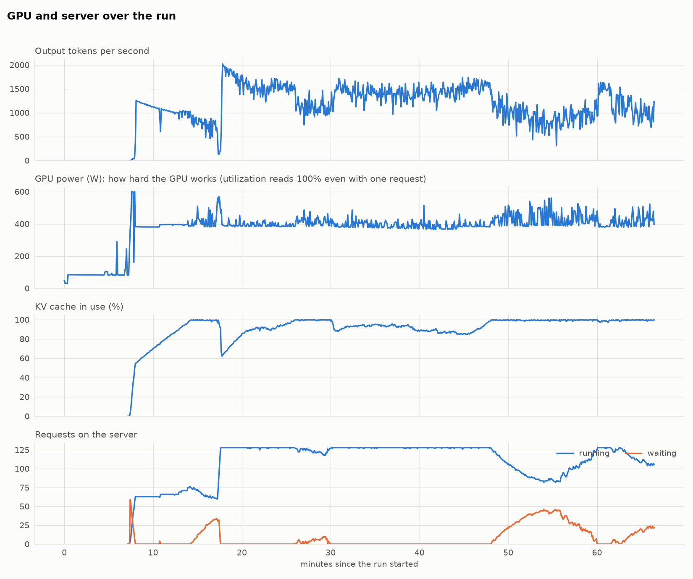
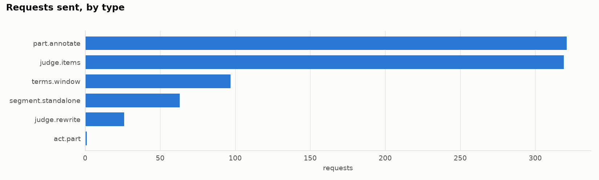
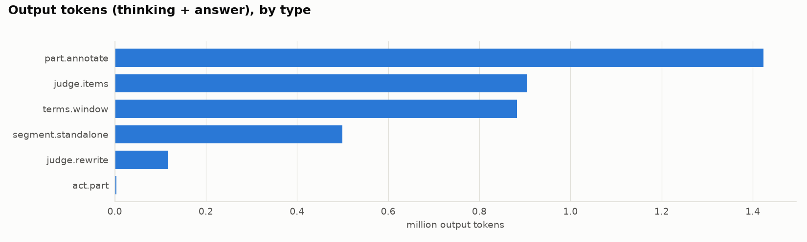

# LIR v2 run `v2-20261103-0755/large`

Foundation for Virtual and Augmented Reality Systems: 63 lectures, 31.0 h of video. Run in progress (partial numbers), 2026-11-03 13:45 to 14:52.

> **Foundation for Virtual and Augmented Reality Systems failed** (exit 143): see `nptel-virtual-and-augmented-reality/stderr.log`.

## Summary

|  | Value |  |
| --- | ---: | --- |
| Wall time | 1 h 07 min | from launch to the last step, server start included |
| Server start | 7.3 min | model load and kernel compile |
| Time per lecture | 57 s | generation time / 63 lectures, both courses sharing the GPU |
| Time per hour of video | 1.9 min |  |
| Requests sent | 827 | 0 were retries |
| Input tokens | 1.4 M |  |
| Output tokens | 3.8 M | thinking + answer |
| Output tokens per second | 1,062 | average over the generation time |
| GPU utilization | 100% | mean while generating (nvidia-smi: busy at all, not how much; see power) |
| GPU memory | 89 of 96 GB | peak |
| Power | 408 W | 0.41 kWh in all |

## Per course

| Course | Lectures | Video | Wall time | GPU time per lecture | Requests | Retries | Cut at length | Input tokens | Output tokens | Thinking share |
| --- | ---: | ---: | ---: | ---: | ---: | ---: | ---: | ---: | ---: | ---: |
| Foundation for Virtual and Augmented Reality Systems | 63 | 31.0 h | 59.2 min | 57 s | 827 | 0 | 8 | 1.4 M | 3.8 M | 92% |

Courses ran one after another, each with the whole GPU. GPU time per lecture is the generation time split by each lecture's share of all output tokens. Thinking share is estimated from the characters of thinking and answer text.

## Setup

|  |  |
| --- | --- |
| GPU | NVIDIA RTX PRO 6000 Blackwell Server Edition, 97887 MiB, 595.112.07 |
| Model (generator, verifier, judge) | Qwen/Qwen3.8-27B-FP8 on vllm 0.32.0, 128 requests at once, GPU memory 0.92 |
| Context | 65,536 tokens; output cap: none |
| Sampling | temperature 0.6, top_p 0.95, top_k 20, min_p 0.0, presence_penalty 0.0 |
| Engine | prefix caching on, priority scheduling |
| Code | commit db66f17 + local changes |
| Lectures | all |

## Server

|  | Value |
| --- | --- |
| Requests running | 110 on average, 128 at most |
| Requests waiting | 59 at most |
| KV cache in use | 92% on average, 100% at most |
| Prefix cache | 0% of prompt tokens reused |
| MTP drafts | 0% of draft tokens accepted, 0.00 tokens per step |
| Preemptions | 1,398 |
| Tokens counted by the server | 1.5 M prompt, 4.3 M generated |

## Foundation for Virtual and Augmented Reality Systems

### Time per step

| Step | Wall time | Share |
| --- | ---: | ---: |

### Requests by type

| Type (prompt) | Step | Requests | Retries | Cut at length | Cache hits | Input tokens | Output tokens | Output per request | Thinking | Latency p50 / p95 (s) |
| --- | --- | ---: | ---: | ---: | ---: | ---: | ---: | ---: | ---: | ---: |
| part.annotate | annotate | 321 | 0 | 2 | 0 | 413,621 | 1,423,731 | 4,435 | 93% | 347 / 809 |
| judge.items | judge | 319 | 0 | 0 | 0 | 470,640 | 903,686 | 2,833 | 90% | 251 / 412 |
| terms.window | terms | 97 | 0 | 0 | 0 | 133,473 | 882,201 | 9,095 | 90% | 891 / 1109 |
| segment.standalone | parts | 63 | 0 | 0 | 0 | 326,862 | 499,560 | 7,930 | 100% | 611 / 621 |
| judge.rewrite | judge | 26 | 0 | 6 | 0 | 34,165 | 116,626 | 4,486 | 97% | 395 / 1240 |
| act.part | activities | 1 | 0 | 0 | 0 | 1,712 | 3,842 | 3,842 | 85% | 501 / 501 |

Latency includes time waiting in the server's queue.

### Per lecture

| Lecture | Title | Video (min) | Requests | Output tokens | GPU min | GPU min per video h | Parts | Key points | Terms | New concepts | Quiz items | Open questions | Flags |
| --- | --- | ---: | ---: | ---: | ---: | ---: | ---: | ---: | ---: | ---: | ---: | ---: | ---: |

Files: `nptel-virtual-and-augmented-reality/lir/` (the LIR), `nptel-virtual-and-augmented-reality/build/` (cache, step outputs, `calls.jsonl` with every request, `report.md`).
