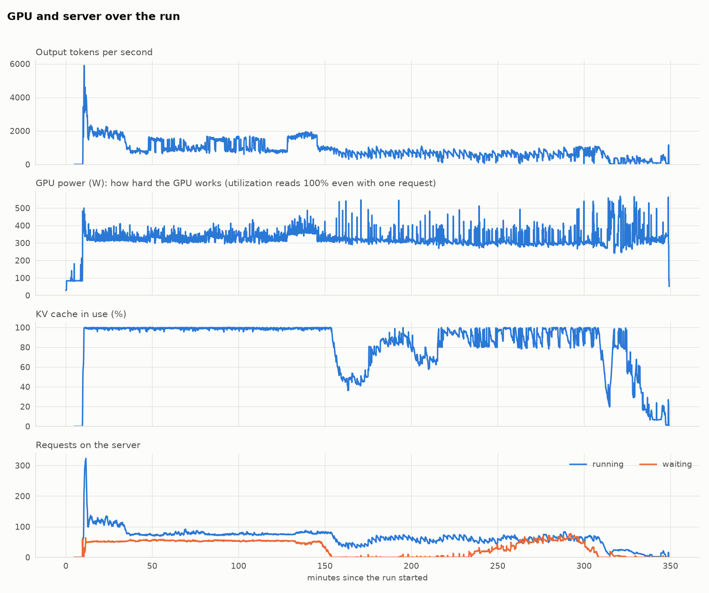
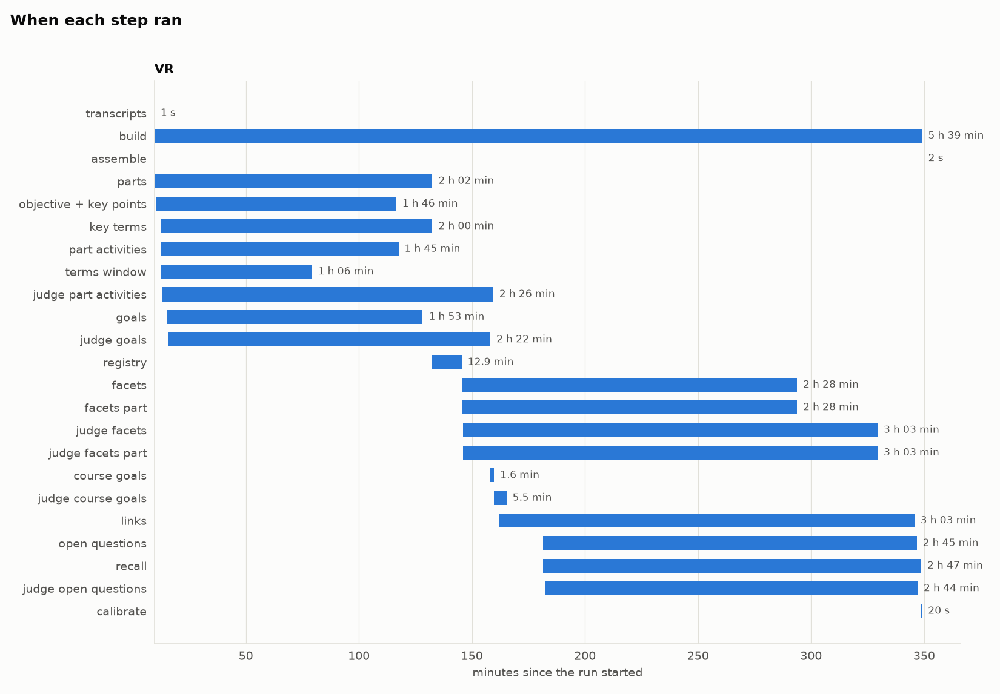
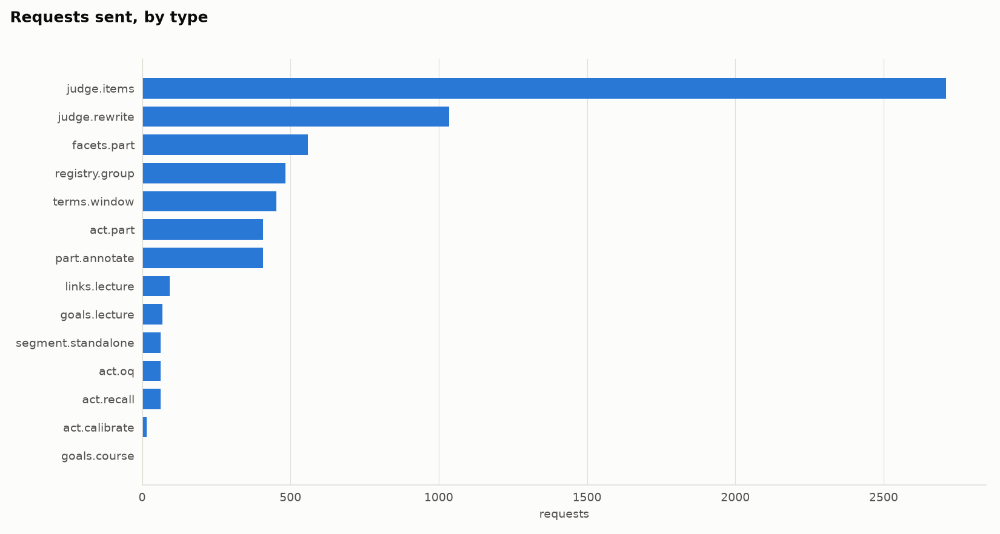
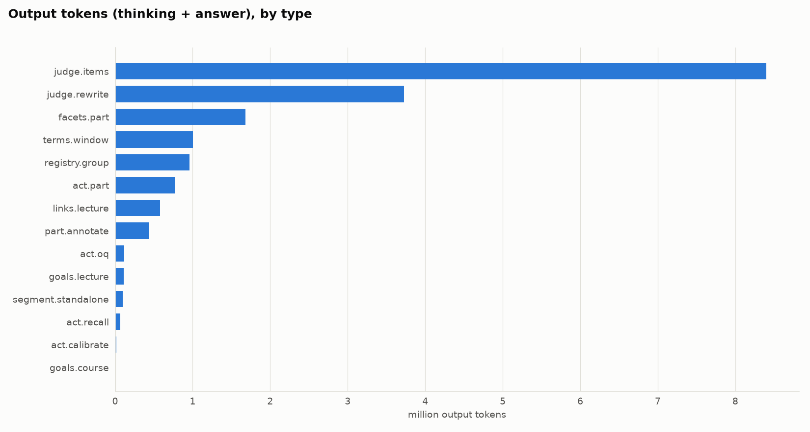
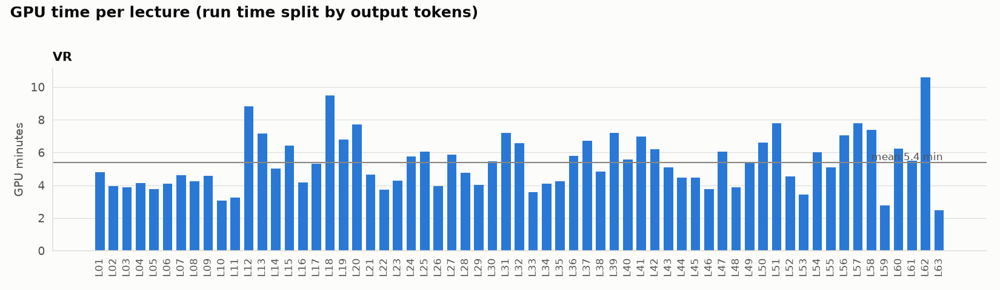

# LIR v2 run `v2-20261103-0755/small`

Foundation for Virtual and Augmented Reality Systems: 63 lectures, 31.0 h of video. Run finished, 2026-11-03 07:55 to 13:45.

## Summary

|  | Value |  |
| --- | ---: | --- |
| Wall time | 5 h 49 min | from launch to the last step, server start included |
| Server start | 9.6 min | model load and kernel compile |
| Time per lecture | 5.4 min | generation time / 63 lectures, both courses sharing the GPU |
| Time per hour of video | 10.9 min |  |
| Requests sent | 6,423 | 111 were retries |
| Input tokens | 17.9 M |  |
| Output tokens | 18.0 M | thinking + answer |
| Output tokens per second | 883 | average over the generation time |
| GPU utilization | 100% | mean while generating (nvidia-smi: busy at all, not how much; see power) |
| GPU memory | 83 of 96 GB | peak |
| Power | 326 W | 1.86 kWh in all |

## Per course

| Course | Lectures | Video | Wall time | GPU time per lecture | Requests | Retries | Cut at length | Input tokens | Output tokens | Thinking share |
| --- | ---: | ---: | ---: | ---: | ---: | ---: | ---: | ---: | ---: | ---: |
| Foundation for Virtual and Augmented Reality Systems | 63 | 31.0 h | 5 h 39 min | 5.4 min | 6,423 | 111 | 141 | 17.9 M | 18.0 M | 84% |

Courses ran one after another, each with the whole GPU. GPU time per lecture is the generation time split by each lecture's share of all output tokens. Thinking share is estimated from the characters of thinking and answer text.

## Setup

|  |  |
| --- | --- |
| GPU | NVIDIA RTX PRO 6000 Blackwell Server Edition, 97887 MiB, 595.112.07 |
| Model (generator) | google/gemma-4-E4B-it on vllm 0.32.0, 256 requests at once, GPU memory 0.34 |
| Model (verifier, judge) | google/gemma-4-12B-it on vllm 0.32.0, 128 requests at once, GPU memory 0.56 |
| Context | 65,536 tokens; output cap: none |
| Sampling | temperature 1.0, top_p 0.95, top_k 64 |
| Engine | prefix caching on, priority scheduling |
| Code | commit db66f17 + local changes |
| Lectures | all |

## Server

|  | Value |
| --- | --- |
| Requests running | 65 on average, 323 at most |
| Requests waiting | 77 at most |
| KV cache in use | 85% on average, 100% at most |
| Prefix cache | 4% of prompt tokens reused |
| MTP drafts | 0% of draft tokens accepted, 0.00 tokens per step |
| Preemptions | 628 |
| Tokens counted by the server | 10.1 M prompt, 13.7 M generated |

## Foundation for Virtual and Augmented Reality Systems

### Time per step

| Step | Wall time | Share |
| --- | ---: | ---: |
| transcripts | 1 s | 0% |
| build | 5 h 39 min | 13% |
| assemble | 2 s | 0% |
| parts | 2 h 02 min | 5% |
| objective + key points | 1 h 46 min | 4% |
| key terms | 2 h 00 min | 5% |
| part activities | 1 h 45 min | 4% |
| terms window | 1 h 06 min | 3% |
| judge part activities | 2 h 26 min | 6% |
| goals | 1 h 53 min | 4% |
| judge goals | 2 h 22 min | 5% |
| registry | 12.9 min | 0% |
| facets | 2 h 28 min | 6% |
| facets part | 2 h 28 min | 6% |
| judge facets | 3 h 03 min | 7% |
| judge facets part | 3 h 03 min | 7% |
| course goals | 1.6 min | 0% |
| judge course goals | 5.5 min | 0% |
| links | 3 h 03 min | 7% |
| open questions | 2 h 45 min | 6% |
| recall | 2 h 47 min | 6% |
| judge open questions | 2 h 44 min | 6% |
| calibrate | 20 s | 0% |

### Requests by type

| Type (prompt) | Step | Requests | Retries | Cut at length | Cache hits | Input tokens | Output tokens | Output per request | Thinking | Latency p50 / p95 (s) |
| --- | --- | ---: | ---: | ---: | ---: | ---: | ---: | ---: | ---: | ---: |
| judge.items | judge | 2,711 | 1 | 1 | 0 | 4,962,007 | 8,401,181 | 3,099 | 90% | 399 / 839 |
| judge.rewrite | judge | 1,035 | 68 | 75 | 2 | 1,224,996 | 3,724,699 | 3,599 | 94% | 433 / 1145 |
| facets.part | facets | 559 | 0 | 0 | 0 | 4,999,866 | 1,679,461 | 3,004 | 70% | 96 / 168 |
| terms.window | terms | 453 | 0 | 0 | 0 | 576,878 | 1,000,805 | 2,209 | 59% | 69 / 109 |
| registry.group | registry | 483 | 0 | 0 | 0 | 334,172 | 961,643 | 1,991 | 88% | 67 / 203 |
| act.part | activities | 408 | 3 | 3 | 0 | 582,473 | 776,804 | 1,904 | 54% | 59 / 86 |
| links.lecture | links | 92 | 30 | 56 | 23 | 3,534,696 | 582,138 | 6,328 | 84% | 705 / 1705 |
| part.annotate | annotate | 407 | 2 | 2 | 0 | 426,381 | 439,191 | 1,079 | 72% | 69 / 94 |
| act.oq | oq | 63 | 0 | 0 | 0 | 658,194 | 118,512 | 1,881 | 43% | 52 / 72 |
| goals.lecture | goals | 69 | 6 | 4 | 0 | 23,641 | 112,348 | 1,628 | 74% | 25 / 260 |
| segment.standalone | parts | 63 | 0 | 0 | 0 | 324,073 | 98,935 | 1,570 | 99% | 55 / 89 |
| act.recall | recall | 62 | 0 | 0 | 0 | 94,914 | 63,436 | 1,023 | 65% | 30 / 46 |
| act.calibrate | calibrate | 16 | 0 | 0 | 0 | 142,100 | 15,859 | 991 | 70% | 18 / 20 |
| goals.course | goals | 2 | 1 | 0 | 0 | 15,441 | 4,023 | 2,012 | 65% | 53 / 53 |

Latency includes time waiting in the server's queue.

### Per lecture

| Lecture | Title | Video (min) | Requests | Output tokens | GPU min | GPU min per video h | Parts | Key points | Terms | New concepts | Quiz items | Open questions | Flags |
| --- | --- | ---: | ---: | ---: | ---: | ---: | ---: | ---: | ---: | ---: | ---: | ---: | ---: |
| L01 | General Intro to XR | 33 | 103 | 254 k | 4.8 | 8.6 | 7 | 24 | 24 | 16 | 12 | 1 | 0 |
| L02 | Application Domains and System Categories | 28 | 80 | 209 k | 4.0 | 8.5 | 5 | 19 | 28 | 22 | 10 | 2 | 0 |
| L03 | Application Domains and System Categories | 21 | 78 | 205 k | 3.9 | 10.9 | 5 | 19 | 24 | 20 | 14 | 1 | 0 |
| L04 | Definitions | 24 | 83 | 219 k | 4.1 | 10.2 | 6 | 18 | 20 | 8 | 10 | 0 | 0 |
| L05 | Definitions | 22 | 72 | 200 k | 3.8 | 10.4 | 5 | 14 | 16 | 4 | 5 | 0 | 0 |
| L06 | Historical Evolution | 28 | 87 | 217 k | 4.1 | 8.8 | 5 | 18 | 41 | 33 | 9 | 2 | 0 |
| L07 | Historial Evolution | 26 | 87 | 245 k | 4.6 | 10.8 | 5 | 20 | 33 | 28 | 14 | 1 | 0 |
| L08 | Issues & Challenges | 32 | 90 | 225 k | 4.2 | 7.9 | 6 | 22 | 19 | 7 | 8 | 2 | 0 |
| L09 | Issues & Challenges | 26 | 98 | 242 k | 4.6 | 10.4 | 6 | 24 | 23 | 15 | 10 | 2 | 1 |
| L10 | Cybersickness | 26 | 56 | 162 k | 3.1 | 7.0 | 3 | 11 | 21 | 15 | 7 | 2 | 1 |
| L11 | Cybersickness | 33 | 70 | 173 k | 3.3 | 6.0 | 3 | 11 | 57 | 45 | 9 | 2 | 0 |
| L12 | Cybersickness | 37 | 154 | 468 k | 8.8 | 14.5 | 11 | 42 | 46 | 35 | 26 | 1 | 0 |
| L13 | VR Hardware | 34 | 139 | 380 k | 7.2 | 12.6 | 9 | 35 | 36 | 26 | 19 | 2 | 0 |
| L14 | VR Hardware | 26 | 88 | 266 k | 5.0 | 11.5 | 5 | 20 | 31 | 25 | 12 | 0 | 0 |
| L15 | AR Hardware | 35 | 106 | 339 k | 6.4 | 11.0 | 7 | 29 | 17 | 12 | 13 | 2 | 0 |
| L16 | Understanding Tracking I | 28 | 80 | 220 k | 4.2 | 9.0 | 5 | 20 | 27 | 12 | 11 | 0 | 0 |
| L17 | Understanding Tracking - I | 25 | 89 | 282 k | 5.3 | 12.6 | 6 | 22 | 42 | 18 | 15 | 2 | 0 |
| L18 | Understanding Tracking II | 33 | 169 | 502 k | 9.5 | 17.2 | 11 | 42 | 58 | 46 | 25 | 2 | 0 |
| L19 | VR Software | 26 | 122 | 360 k | 6.8 | 15.5 | 8 | 31 | 47 | 29 | 15 | 1 | 0 |
| L20 | VR Software | 36 | 151 | 409 k | 7.7 | 12.8 | 10 | 38 | 66 | 41 | 19 | 1 | 0 |
| L21 | AR Software | 27 | 81 | 246 k | 4.7 | 10.4 | 4 | 14 | 45 | 37 | 9 | 0 | 1 |
| L22 | AR Software | 20 | 64 | 197 k | 3.7 | 11.2 | 4 | 14 | 17 | 12 | 9 | 1 | 0 |
| L23 | XR as Interactive Systems | 22 | 84 | 227 k | 4.3 | 11.8 | 5 | 20 | 15 | 13 | 12 | 1 | 0 |
| L24 | XR as Interactive Systems | 26 | 112 | 306 k | 5.8 | 13.1 | 7 | 24 | 36 | 19 | 11 | 2 | 0 |
| L25 | Human Factors in XR | 26 | 110 | 320 k | 6.0 | 13.8 | 7 | 24 | 27 | 17 | 13 | 1 | 0 |
| L26 | Human Factors in XR | 25 | 84 | 208 k | 3.9 | 9.4 | 6 | 23 | 30 | 16 | 12 | 1 | 0 |
| L27 | Visual Perception & Displays I | 31 | 103 | 311 k | 5.9 | 11.4 | 6 | 23 | 38 | 31 | 8 | 0 | 1 |
| L28 | Visual Perception & Displays II | 29 | 89 | 252 k | 4.8 | 9.9 | 6 | 22 | 34 | 24 | 14 | 2 | 0 |
| L29 | Auditory Sense & Immersive Experience | 20 | 78 | 213 k | 4.0 | 11.9 | 5 | 17 | 23 | 18 | 5 | 1 | 0 |
| L30 | Auditory Sense & Immersive Experience | 29 | 99 | 289 k | 5.5 | 11.3 | 6 | 25 | 28 | 21 | 15 | 1 | 1 |
| L31 | Other Senses & Full Immersion | 34 | 141 | 381 k | 7.2 | 12.6 | 9 | 32 | 57 | 34 | 13 | 1 | 1 |
| L32 | Interactive System Development Life Cycle Stages | 38 | 124 | 348 k | 6.6 | 10.4 | 8 | 30 | 35 | 19 | 18 | 0 | 0 |
| L33 | Introduction to Majuli case study | 24 | 73 | 189 k | 3.6 | 9.1 | 6 | 23 | 11 | 6 | 13 | 0 | 0 |
| L34 | Introduction to Majuli case study | 22 | 73 | 216 k | 4.1 | 10.9 | 4 | 15 | 17 | 11 | 6 | 0 | 0 |
| L35 | Usability requirement gathering and specificatio | 23 | 83 | 225 k | 4.2 | 11.1 | 5 | 20 | 24 | 11 | 9 | 0 | 0 |
| L36 | Usability requirement gathering and specificatio | 32 | 109 | 307 k | 5.8 | 10.7 | 7 | 28 | 26 | 12 | 18 | 0 | 0 |
| L37 | Usability requirement gathering and specificatio | 29 | 112 | 355 k | 6.7 | 13.8 | 7 | 23 | 32 | 13 | 14 | 1 | 1 |
| L38 | System Design | 30 | 82 | 256 k | 4.8 | 9.5 | 4 | 13 | 44 | 35 | 7 | 1 | 1 |
| L39 | System Design | 47 | 156 | 382 k | 7.2 | 9.2 | 9 | 37 | 62 | 47 | 17 | 1 | 1 |
| L40 | System Design | 32 | 111 | 295 k | 5.6 | 10.5 | 7 | 28 | 42 | 28 | 20 | 0 | 1 |
| L41 | System Design | 29 | 129 | 369 k | 7.0 | 14.4 | 9 | 35 | 41 | 21 | 18 | 0 | 1 |
| L42 | System Implementation | 41 | 119 | 329 k | 6.2 | 9.1 | 8 | 29 | 42 | 20 | 18 | 2 | 1 |
| L43 | System Implementation | 23 | 84 | 269 k | 5.1 | 13.3 | 5 | 18 | 48 | 27 | 9 | 2 | 0 |
| L44 | System Implementation | 32 | 83 | 237 k | 4.5 | 8.3 | 4 | 16 | 46 | 24 | 9 | 1 | 1 |
| L45 | System Implementation | 32 | 91 | 237 k | 4.5 | 8.5 | 6 | 20 | 34 | 18 | 12 | 0 | 1 |
| L46 | System Implementation | 37 | 68 | 200 k | 3.8 | 6.1 | 3 | 13 | 37 | 27 | 7 | 2 | 0 |
| L47 | System Implementation | 30 | 118 | 320 k | 6.0 | 11.9 | 9 | 32 | 27 | 13 | 16 | 0 | 1 |
| L48 | System Implementation | 21 | 72 | 206 k | 3.9 | 11.0 | 4 | 14 | 37 | 21 | 7 | 1 | 0 |
| L49 | VR experience optimisation | 27 | 106 | 288 k | 5.4 | 12.0 | 7 | 23 | 24 | 10 | 11 | 0 | 1 |
| L50 | VR experience optimisation | 29 | 119 | 350 k | 6.6 | 13.5 | 8 | 29 | 28 | 19 | 12 | 1 | 2 |
| L51 | VR experience optimisation | 46 | 150 | 412 k | 7.8 | 10.2 | 10 | 40 | 54 | 26 | 21 | 0 | 1 |
| L52 | VR experience optimisation | 21 | 90 | 240 k | 4.5 | 12.7 | 6 | 23 | 30 | 15 | 13 | 1 | 1 |
| L53 | VR experience optimisation | 20 | 73 | 182 k | 3.4 | 10.2 | 5 | 17 | 31 | 10 | 13 | 1 | 1 |
| L54 | VR resource optimization | 36 | 118 | 318 k | 6.0 | 10.1 | 7 | 26 | 34 | 25 | 10 | 1 | 1 |
| L55 | VR resource optimization | 40 | 98 | 270 k | 5.1 | 7.7 | 6 | 23 | 50 | 32 | 11 | 2 | 1 |
| L56 | VR resource optimization | 43 | 136 | 374 k | 7.1 | 9.7 | 8 | 29 | 68 | 38 | 20 | 0 | 1 |
| L57 | VR resource optimization | 42 | 157 | 413 k | 7.8 | 11.1 | 10 | 39 | 82 | 26 | 18 | 3 | 1 |
| L58 | VR resource optimization | 38 | 135 | 391 k | 7.4 | 11.7 | 9 | 32 | 70 | 35 | 15 | 1 | 1 |
| L59 | VR resource optimization | 16 | 54 | 147 k | 2.8 | 10.5 | 3 | 11 | 18 | 4 | 5 | 2 | 1 |
| L60 | Linking theory to practice | 20 | 116 | 330 k | 6.2 | 18.3 | 7 | 25 | 23 | 12 | 10 | 1 | 1 |
| L61 | Linking theory to practice | 29 | 104 | 292 k | 5.5 | 11.4 | 7 | 31 | 53 | 43 | 18 | 1 | 1 |
| L62 | Linking theory to practice | 44 | 178 | 562 k | 10.6 | 14.4 | 11 | 43 | 72 | 46 | 26 | 0 | 1 |
| L63 | Concluding remarks | 15 | 52 | 131 k | 2.5 | 9.7 | 3 | 6 | 10 | 2 | 3 | 0 | 2 |
| course | course goals and other course-level requests |  | 3 | 8 k | 0.2 |  |  |  |  |  |  |  |  |

### What was built

|  | Count |
| --- | ---: |
| Parts | 405 |
| Key points | 1,508 |
| Key-term occurrences | 2,278 |
| Concepts | 1,395 |
| Links | 814 (depends_on 189, kind_of 330, part_of 295) |
| Recall items | 247 |
| Quiz items | 808 |
| Recaps | 405 |
| Check-yourself questions | 562 |
| Spaced-review candidates | 338 |
| Concept-map nodes | 853 |
| Open questions | 62 |
| Flags | 32 |

Every decision by step

| Step: decision | Count |
| --- | ---: |
| annotate: key point dropped | 126 |
| concept_map: 10 of 29 concepts, 8 links | 1 |
| concept_map: 11 of 16 concepts, 11 links | 1 |
| concept_map: 12 of 17 concepts, 9 links | 1 |
| concept_map: 14 of 107 concepts, 3 links | 1 |
| concept_map: 14 of 16 concepts, 16 links | 1 |
| concept_map: 14 of 19 concepts, 21 links | 1 |
| concept_map: 14 of 23 concepts, 10 links | 1 |
| concept_map: 14 of 24 concepts, 13 links | 1 |
| concept_map: 14 of 28 concepts, 13 links | 1 |
| concept_map: 14 of 28 concepts, 17 links | 1 |
| concept_map: 14 of 30 concepts, 10 links | 1 |
| concept_map: 14 of 30 concepts, 13 links | 1 |
| concept_map: 14 of 34 concepts, 13 links | 1 |
| concept_map: 14 of 37 concepts, 15 links | 1 |
| concept_map: 14 of 37 concepts, 8 links | 1 |
| concept_map: 14 of 39 concepts, 15 links | 1 |
| concept_map: 14 of 41 concepts, 10 links | 1 |
| concept_map: 14 of 42 concepts, 2 links | 1 |
| concept_map: 14 of 43 concepts, 9 links | 1 |
| concept_map: 14 of 44 concepts, 10 links | 1 |
| concept_map: 14 of 44 concepts, 15 links | 1 |
| concept_map: 14 of 44 concepts, 9 links | 2 |
| concept_map: 14 of 45 concepts, 11 links | 1 |
| concept_map: 14 of 45 concepts, 2 links | 1 |
| concept_map: 14 of 46 concepts, 10 links | 1 |
| concept_map: 14 of 46 concepts, 13 links | 1 |
| concept_map: 14 of 47 concepts, 4 links | 1 |
| concept_map: 14 of 50 concepts, 10 links | 1 |
| concept_map: 14 of 50 concepts, 11 links | 1 |
| concept_map: 14 of 50 concepts, 6 links | 1 |
| concept_map: 14 of 52 concepts, 3 links | 1 |
| concept_map: 14 of 53 concepts, 1 links | 1 |
| concept_map: 14 of 53 concepts, 18 links | 1 |
| concept_map: 14 of 53 concepts, 3 links | 1 |
| concept_map: 14 of 53 concepts, 7 links | 1 |
| concept_map: 14 of 55 concepts, 10 links | 1 |
| concept_map: 14 of 56 concepts, 2 links | 1 |
| concept_map: 14 of 56 concepts, 6 links | 1 |
| concept_map: 14 of 58 concepts, 11 links | 1 |
| concept_map: 14 of 58 concepts, 12 links | 1 |
| concept_map: 14 of 58 concepts, 2 links | 1 |
| concept_map: 14 of 59 concepts, 2 links | 1 |
| concept_map: 14 of 60 concepts, 4 links | 1 |
| concept_map: 14 of 60 concepts, 8 links | 1 |
| concept_map: 14 of 61 concepts, 12 links | 1 |
| concept_map: 14 of 66 concepts, 4 links | 1 |
| concept_map: 14 of 68 concepts, 4 links | 1 |
| concept_map: 14 of 68 concepts, 9 links | 1 |
| concept_map: 14 of 70 concepts, 2 links | 1 |
| concept_map: 14 of 70 concepts, 4 links | 1 |
| concept_map: 14 of 72 concepts, 0 links | 1 |
| concept_map: 14 of 73 concepts, 3 links | 1 |
| concept_map: 14 of 75 concepts, 3 links | 1 |
| concept_map: 14 of 78 concepts, 2 links | 1 |
| concept_map: 14 of 81 concepts, 10 links | 1 |
| concept_map: 14 of 86 concepts, 4 links | 1 |
| concept_map: 14 of 95 concepts, 2 links | 1 |
| concept_map: 14 of 95 concepts, 4 links | 1 |
| concept_map: 14 of 99 concepts, 1 links | 1 |
| concept_map: 6 of 43 concepts, 3 links | 1 |
| concept_map: 8 of 13 concepts, 8 links | 1 |
| concept_map: 8 of 57 concepts, 3 links | 1 |
| facets: kept as a mention | 26 |
| goals: one objective per part | 1 |
| judge: facet became a mention | 328 |
| judge: failed | 2,847 |
| judge: key point dropped | 5 |
| judge: key term dropped | 522 |
| judge: open question dropped | 1 |
| judge: passed | 10,672 |
| judge: quiz item dropped | 76 |
| judge: recap replaced by the key points | 1 |
| judge: repaired | 1,825 |
| judge: reversed | 14 |
| judge: review question dropped | 18 |
| judge: rewrite failed | 711 |
| judge: rewrite rejected by code | 40 |
| lecture_map: kept 3 of 10 incoming links | 1 |
| lecture_map: kept 3 of 11 incoming links | 1 |
| lecture_map: kept 3 of 12 incoming links | 6 |
| lecture_map: kept 3 of 13 incoming links | 7 |
| lecture_map: kept 3 of 14 incoming links | 6 |
| lecture_map: kept 3 of 15 incoming links | 1 |
| lecture_map: kept 3 of 16 incoming links | 2 |
| lecture_map: kept 3 of 17 incoming links | 2 |
| lecture_map: kept 3 of 19 incoming links | 2 |
| lecture_map: kept 3 of 21 incoming links | 3 |
| lecture_map: kept 3 of 22 incoming links | 2 |
| lecture_map: kept 3 of 23 incoming links | 2 |
| lecture_map: kept 3 of 24 incoming links | 1 |
| lecture_map: kept 3 of 26 incoming links | 4 |
| lecture_map: kept 3 of 27 incoming links | 1 |
| lecture_map: kept 3 of 28 incoming links | 2 |
| lecture_map: kept 3 of 30 incoming links | 1 |
| lecture_map: kept 3 of 4 incoming links | 2 |
| lecture_map: kept 3 of 5 incoming links | 5 |
| lecture_map: kept 3 of 6 incoming links | 1 |
| lecture_map: kept 3 of 7 incoming links | 3 |
| lecture_map: kept 3 of 8 incoming links | 1 |
| lecture_map: kept 3 of 9 incoming links | 2 |
| links: conflict | 24 |
| links: dropped | 192 |
| links: flipped | 14 |
| oq: key points dropped | 27 |
| oq: question dropped | 70 |
| parts: 10 parts | 3 |
| parts: 11 parts | 3 |
| parts: 3 parts | 5 |
| parts: 4 parts | 6 |
| parts: 5 parts | 12 |
| parts: 6 parts | 12 |
| parts: 7 parts | 11 |
| parts: 8 parts | 5 |
| parts: 9 parts | 6 |
| quiz: item dropped | 25 |
| quiz: multiple_choice on L01/P01/K1 | 1 |
| quiz: multiple_choice on L01/P02/K3 | 1 |
| quiz: multiple_choice on L01/P03/K1 | 1 |
| quiz: multiple_choice on L01/P04/K2 | 1 |
| quiz: multiple_choice on L01/P04/K4 | 1 |
| quiz: multiple_choice on L01/P05/K1 | 1 |
| quiz: multiple_choice on L01/P05/K3 | 1 |
| quiz: multiple_choice on L01/P06/K1 | 1 |
| quiz: multiple_choice on L01/P07/K1 | 1 |
| quiz: multiple_choice on L02/P01/K2 | 1 |
| quiz: multiple_choice on L02/P02/K1 | 1 |
| quiz: multiple_choice on L02/P02/K4 | 1 |
| quiz: multiple_choice on L02/P03/K4 | 1 |
| quiz: multiple_choice on L02/P04/K1 | 1 |
| quiz: multiple_choice on L02/P05/K1 | 1 |
| quiz: multiple_choice on L03/P01/K1 | 1 |
| quiz: multiple_choice on L03/P01/K2 | 1 |
| quiz: multiple_choice on L03/P02/K1 | 1 |
| quiz: multiple_choice on L03/P03/K2 | 1 |
| quiz: multiple_choice on L03/P03/K4 | 1 |
| quiz: multiple_choice on L03/P04/K2 | 1 |
| quiz: multiple_choice on L03/P04/K3 | 1 |
| quiz: multiple_choice on L03/P05/K1 | 1 |
| quiz: multiple_choice on L03/P05/K4 | 1 |
| quiz: multiple_choice on L04/P01/K1 | 1 |
| quiz: multiple_choice on L04/P02/K1 | 1 |
| quiz: multiple_choice on L04/P03/K1 | 1 |
| quiz: multiple_choice on L04/P04/K2 | 1 |
| quiz: multiple_choice on L04/P05/K3 | 1 |
| quiz: multiple_choice on L04/P06/K2 | 1 |
| quiz: multiple_choice on L05/P01/K2 | 1 |
| quiz: multiple_choice on L05/P02/K1 | 1 |
| quiz: multiple_choice on L05/P03/K2 | 1 |
| quiz: multiple_choice on L05/P04/K1 | 1 |
| quiz: multiple_choice on L05/P05/K1 | 1 |
| quiz: multiple_choice on L06/P01/K2 | 1 |
| quiz: multiple_choice on L06/P02/K4 | 1 |
| quiz: multiple_choice on L06/P03/K1 | 1 |
| quiz: multiple_choice on L06/P03/K3 | 1 |
| quiz: multiple_choice on L06/P04/K4 | 1 |
| quiz: multiple_choice on L06/P05/K1 | 1 |
| quiz: multiple_choice on L07/P01/K1 | 1 |
| quiz: multiple_choice on L07/P01/K3 | 1 |
| quiz: multiple_choice on L07/P02/K2 | 1 |
| quiz: multiple_choice on L07/P03/K1 | 1 |
| quiz: multiple_choice on L07/P03/K2 | 1 |
| quiz: multiple_choice on L07/P04/K1 | 1 |
| quiz: multiple_choice on L07/P05/K1 | 1 |
| quiz: multiple_choice on L07/P05/K2 | 1 |
| quiz: multiple_choice on L08/P02/K4 | 1 |
| quiz: multiple_choice on L08/P03/K2 | 1 |
| quiz: multiple_choice on L08/P04/K2 | 1 |
| quiz: multiple_choice on L08/P04/K3 | 1 |
| quiz: multiple_choice on L08/P05/K2 | 1 |
| quiz: multiple_choice on L08/P05/K3 | 1 |
| quiz: multiple_choice on L08/P06/K1 | 1 |
| quiz: multiple_choice on L09/P01/K1 | 1 |
| quiz: multiple_choice on L09/P02/K1 | 1 |
| quiz: multiple_choice on L09/P03/K1 | 1 |
| quiz: multiple_choice on L09/P03/K3 | 1 |
| quiz: multiple_choice on L09/P04/K1 | 1 |
| quiz: multiple_choice on L09/P05/K1 | 1 |
| quiz: multiple_choice on L09/P06/K2 | 1 |
| quiz: multiple_choice on L09/P06/K4 | 1 |
| quiz: multiple_choice on L10/P01/K3 | 1 |
| quiz: multiple_choice on L10/P02/K1 | 1 |
| quiz: multiple_choice on L10/P02/K3 | 1 |
| quiz: multiple_choice on L10/P03/K1 | 1 |
| quiz: multiple_choice on L10/P03/K2 | 1 |
| quiz: multiple_choice on L11/P01/K1 | 1 |
| quiz: multiple_choice on L11/P02/K2 | 1 |
| quiz: multiple_choice on L11/P02/K3 | 1 |
| quiz: multiple_choice on L11/P03/K1 | 1 |
| quiz: multiple_choice on L11/P03/K4 | 1 |
| quiz: multiple_choice on L12/P01/K1 | 1 |
| quiz: multiple_choice on L12/P01/K2 | 1 |
| quiz: multiple_choice on L12/P02/K1 | 1 |
| quiz: multiple_choice on L12/P03/K2 | 1 |
| quiz: multiple_choice on L12/P04/K1 | 1 |
| quiz: multiple_choice on L12/P05/K2 | 1 |
| quiz: multiple_choice on L12/P06/K1 | 1 |
| quiz: multiple_choice on L12/P06/K3 | 1 |
| quiz: multiple_choice on L12/P07/K1 | 1 |
| quiz: multiple_choice on L12/P08/K2 | 1 |
| quiz: multiple_choice on L12/P08/K4 | 1 |
| quiz: multiple_choice on L12/P09/K1 | 1 |
| quiz: multiple_choice on L12/P09/K3 | 1 |
| quiz: multiple_choice on L12/P10/K1 | 1 |
| quiz: multiple_choice on L12/P10/K3 | 1 |
| quiz: multiple_choice on L12/P11/K1 | 1 |
| quiz: multiple_choice on L13/P01/K1 | 1 |
| quiz: multiple_choice on L13/P01/K2 | 1 |
| quiz: multiple_choice on L13/P02/K3 | 1 |
| quiz: multiple_choice on L13/P03/K2 | 1 |
| quiz: multiple_choice on L13/P04/K3 | 1 |
| quiz: multiple_choice on L13/P05/K1 | 1 |
| quiz: multiple_choice on L13/P05/K3 | 1 |
| quiz: multiple_choice on L13/P06/K3 | 1 |
| quiz: multiple_choice on L13/P06/K4 | 1 |
| quiz: multiple_choice on L13/P07/K2 | 1 |
| quiz: multiple_choice on L13/P08/K1 | 1 |
| quiz: multiple_choice on L13/P08/K3 | 1 |
| quiz: multiple_choice on L13/P09/K1 | 1 |
| quiz: multiple_choice on L14/P01/K3 | 1 |
| quiz: multiple_choice on L14/P02/K1 | 1 |
| quiz: multiple_choice on L14/P02/K3 | 1 |
| quiz: multiple_choice on L14/P03/K2 | 1 |
| quiz: multiple_choice on L14/P04/K1 | 1 |
| quiz: multiple_choice on L14/P04/K4 | 1 |
| quiz: multiple_choice on L14/P05/K2 | 1 |
| quiz: multiple_choice on L15/P01/K2 | 1 |
| quiz: multiple_choice on L15/P02/K1 | 1 |
| quiz: multiple_choice on L15/P03/K1 | 1 |
| quiz: multiple_choice on L15/P03/K5 | 1 |
| quiz: multiple_choice on L15/P04/K4 | 1 |
| quiz: multiple_choice on L15/P05/K1 | 1 |
| quiz: multiple_choice on L15/P05/K2 | 1 |
| quiz: multiple_choice on L15/P05/K4 | 1 |
| quiz: multiple_choice on L15/P06/K1 | 1 |
| quiz: multiple_choice on L15/P07/K1 | 1 |
| quiz: multiple_choice on L16/P01/K2 | 1 |
| quiz: multiple_choice on L16/P01/K3 | 1 |
| quiz: multiple_choice on L16/P02/K4 | 1 |
| quiz: multiple_choice on L16/P04/K3 | 1 |
| quiz: multiple_choice on L16/P05/K2 | 1 |
| quiz: multiple_choice on L17/P01/K1 | 1 |
| quiz: multiple_choice on L17/P01/K2 | 1 |
| quiz: multiple_choice on L17/P02/K1 | 1 |
| quiz: multiple_choice on L17/P02/K3 | 1 |
| quiz: multiple_choice on L17/P03/K1 | 1 |
| quiz: multiple_choice on L17/P03/K4 | 1 |
| quiz: multiple_choice on L17/P04/K1 | 1 |
| quiz: multiple_choice on L17/P04/K4 | 1 |
| quiz: multiple_choice on L17/P05/K1 | 1 |
| quiz: multiple_choice on L17/P05/K3 | 1 |
| quiz: multiple_choice on L17/P06/K3 | 1 |
| quiz: multiple_choice on L18/P01/K1 | 1 |
| quiz: multiple_choice on L18/P01/K3 | 1 |
| quiz: multiple_choice on L18/P02/K1 | 1 |
| quiz: multiple_choice on L18/P02/K3 | 1 |
| quiz: multiple_choice on L18/P02/K4 | 1 |
| quiz: multiple_choice on L18/P03/K2 | 1 |
| quiz: multiple_choice on L18/P03/K4 | 1 |
| quiz: multiple_choice on L18/P04/K1 | 1 |
| quiz: multiple_choice on L18/P04/K3 | 1 |
| quiz: multiple_choice on L18/P05/K4 | 1 |
| quiz: multiple_choice on L18/P06/K3 | 1 |
| quiz: multiple_choice on L18/P07/K2 | 1 |
| quiz: multiple_choice on L18/P08/K1 | 1 |
| quiz: multiple_choice on L18/P08/K4 | 1 |
| quiz: multiple_choice on L18/P09/K1 | 1 |
| quiz: multiple_choice on L18/P10/K1 | 1 |
| quiz: multiple_choice on L18/P10/K2 | 1 |
| quiz: multiple_choice on L18/P11/K3 | 1 |
| quiz: multiple_choice on L19/P01/K2 | 1 |
| quiz: multiple_choice on L19/P02/K2 | 1 |
| quiz: multiple_choice on L19/P04/K3 | 1 |
| quiz: multiple_choice on L19/P05/K3 | 1 |
| quiz: multiple_choice on L19/P06/K1 | 1 |
| quiz: multiple_choice on L19/P06/K2 | 1 |
| quiz: multiple_choice on L19/P07/K3 | 1 |
| quiz: multiple_choice on L19/P08/K1 | 1 |
| quiz: multiple_choice on L20/P01/K1 | 1 |
| quiz: multiple_choice on L20/P01/K4 | 1 |
| quiz: multiple_choice on L20/P02/K3 | 1 |
| quiz: multiple_choice on L20/P03/K2 | 1 |
| quiz: multiple_choice on L20/P04/K1 | 1 |
| quiz: multiple_choice on L20/P05/K1 | 1 |
| quiz: multiple_choice on L20/P06/K1 | 1 |
| quiz: multiple_choice on L20/P06/K2 | 1 |
| quiz: multiple_choice on L20/P07/K1 | 1 |
| quiz: multiple_choice on L20/P07/K4 | 1 |
| quiz: multiple_choice on L20/P08/K1 | 1 |
| quiz: multiple_choice on L20/P08/K4 | 1 |
| quiz: multiple_choice on L20/P09/K1 | 1 |
| quiz: multiple_choice on L20/P10/K2 | 1 |
| quiz: multiple_choice on L21/P01/K3 | 1 |
| quiz: multiple_choice on L21/P02/K2 | 1 |
| quiz: multiple_choice on L21/P02/K3 | 1 |
| quiz: multiple_choice on L21/P03/K2 | 1 |
| quiz: multiple_choice on L21/P03/K4 | 1 |
| quiz: multiple_choice on L21/P04/K1 | 1 |
| quiz: multiple_choice on L21/P04/K2 | 1 |
| quiz: multiple_choice on L22/P01/K3 | 1 |
| quiz: multiple_choice on L22/P02/K1 | 1 |
| quiz: multiple_choice on L22/P03/K1 | 1 |
| quiz: multiple_choice on L22/P03/K3 | 1 |
| quiz: multiple_choice on L22/P04/K2 | 1 |
| quiz: multiple_choice on L23/P01/K3 | 1 |
| quiz: multiple_choice on L23/P02/K3 | 1 |
| quiz: multiple_choice on L23/P03/K2 | 1 |
| quiz: multiple_choice on L23/P04/K1 | 1 |
| quiz: multiple_choice on L23/P05/K4 | 1 |
| quiz: multiple_choice on L24/P02/K2 | 1 |
| quiz: multiple_choice on L24/P03/K2 | 1 |
| quiz: multiple_choice on L24/P04/K4 | 1 |
| quiz: multiple_choice on L24/P05/K1 | 1 |
| quiz: multiple_choice on L24/P05/K4 | 1 |
| quiz: multiple_choice on L24/P06/K2 | 1 |
| quiz: multiple_choice on L24/P07/K1 | 1 |
| quiz: multiple_choice on L25/P01/K2 | 1 |
| quiz: multiple_choice on L25/P02/K2 | 1 |
| quiz: multiple_choice on L25/P03/K3 | 1 |
| quiz: multiple_choice on L25/P04/K1 | 1 |
| quiz: multiple_choice on L25/P04/K4 | 1 |
| quiz: multiple_choice on L25/P05/K1 | 1 |
| quiz: multiple_choice on L25/P05/K4 | 1 |
| quiz: multiple_choice on L25/P06/K1 | 1 |
| quiz: multiple_choice on L25/P07/K1 | 1 |
| quiz: multiple_choice on L25/P07/K4 | 1 |
| quiz: multiple_choice on L26/P01/K3 | 1 |
| quiz: multiple_choice on L26/P01/K4 | 1 |
| quiz: multiple_choice on L26/P02/K1 | 1 |
| quiz: multiple_choice on L26/P02/K3 | 1 |
| quiz: multiple_choice on L26/P03/K1 | 1 |
| quiz: multiple_choice on L26/P04/K3 | 1 |
| quiz: multiple_choice on L26/P06/K1 | 1 |
| quiz: multiple_choice on L27/P01/K1 | 1 |
| quiz: multiple_choice on L27/P02/K1 | 1 |
| quiz: multiple_choice on L27/P02/K3 | 1 |
| quiz: multiple_choice on L27/P03/K1 | 1 |
| quiz: multiple_choice on L27/P04/K4 | 1 |
| quiz: multiple_choice on L27/P05/K3 | 1 |
| quiz: multiple_choice on L27/P06/K2 | 1 |
| quiz: multiple_choice on L28/P01/K1 | 1 |
| quiz: multiple_choice on L28/P01/K3 | 1 |
| quiz: multiple_choice on L28/P02/K1 | 1 |
| quiz: multiple_choice on L28/P02/K3 | 1 |
| quiz: multiple_choice on L28/P03/K1 | 1 |
| quiz: multiple_choice on L28/P04/K2 | 1 |
| quiz: multiple_choice on L28/P05/K2 | 1 |
| quiz: multiple_choice on L28/P06/K1 | 1 |
| quiz: multiple_choice on L29/P01/K1 | 1 |
| quiz: multiple_choice on L29/P02/K2 | 1 |
| quiz: multiple_choice on L29/P03/K1 | 1 |
| quiz: multiple_choice on L29/P04/K3 | 1 |
| quiz: multiple_choice on L29/P05/K1 | 1 |
| quiz: multiple_choice on L30/P01/K3 | 1 |
| quiz: multiple_choice on L30/P01/K5 | 1 |
| quiz: multiple_choice on L30/P02/K1 | 1 |
| quiz: multiple_choice on L30/P03/K3 | 1 |
| quiz: multiple_choice on L30/P04/K2 | 1 |
| quiz: multiple_choice on L30/P04/K3 | 1 |
| quiz: multiple_choice on L30/P04/K4 | 1 |
| quiz: multiple_choice on L30/P05/K1 | 1 |
| quiz: multiple_choice on L30/P06/K2 | 1 |
| quiz: multiple_choice on L30/P06/K4 | 1 |
| quiz: multiple_choice on L31/P01/K1 | 1 |
| quiz: multiple_choice on L31/P02/K4 | 1 |
| quiz: multiple_choice on L31/P03/K2 | 1 |
| quiz: multiple_choice on L31/P04/K4 | 1 |
| quiz: multiple_choice on L31/P05/K2 | 1 |
| quiz: multiple_choice on L31/P05/K3 | 1 |
| quiz: multiple_choice on L31/P06/K2 | 1 |
| quiz: multiple_choice on L31/P07/K2 | 1 |
| quiz: multiple_choice on L31/P08/K1 | 1 |
| quiz: multiple_choice on L31/P09/K2 | 1 |
| quiz: multiple_choice on L32/P01/K2 | 1 |
| quiz: multiple_choice on L32/P01/K3 | 1 |
| quiz: multiple_choice on L32/P02/K1 | 1 |
| quiz: multiple_choice on L32/P02/K2 | 1 |
| quiz: multiple_choice on L32/P03/K1 | 1 |
| quiz: multiple_choice on L32/P04/K1 | 1 |
| quiz: multiple_choice on L32/P04/K3 | 1 |
| quiz: multiple_choice on L32/P05/K1 | 1 |
| quiz: multiple_choice on L32/P05/K3 | 1 |
| quiz: multiple_choice on L32/P06/K1 | 1 |
| quiz: multiple_choice on L32/P06/K4 | 1 |
| quiz: multiple_choice on L32/P07/K4 | 1 |
| quiz: multiple_choice on L32/P08/K2 | 1 |
| quiz: multiple_choice on L33/P01/K1 | 1 |
| quiz: multiple_choice on L33/P02/K1 | 1 |
| quiz: multiple_choice on L33/P03/K4 | 1 |
| quiz: multiple_choice on L33/P04/K4 | 1 |
| quiz: multiple_choice on L33/P05/K3 | 1 |
| quiz: multiple_choice on L33/P05/K4 | 1 |
| quiz: multiple_choice on L33/P06/K1 | 1 |
| quiz: multiple_choice on L33/P06/K4 | 1 |
| quiz: multiple_choice on L34/P01/K2 | 1 |
| quiz: multiple_choice on L34/P02/K2 | 1 |
| quiz: multiple_choice on L34/P03/K2 | 1 |
| quiz: multiple_choice on L35/P02/K1 | 1 |
| quiz: multiple_choice on L35/P03/K2 | 1 |
| quiz: multiple_choice on L35/P04/K4 | 1 |
| quiz: multiple_choice on L35/P05/K1 | 1 |
| quiz: multiple_choice on L35/P05/K3 | 1 |
| quiz: multiple_choice on L36/P01/K1 | 1 |
| quiz: multiple_choice on L36/P01/K3 | 1 |
| quiz: multiple_choice on L36/P02/K1 | 1 |
| quiz: multiple_choice on L36/P02/K3 | 1 |
| quiz: multiple_choice on L36/P03/K1 | 1 |
| quiz: multiple_choice on L36/P03/K3 | 1 |
| quiz: multiple_choice on L36/P03/K4 | 1 |
| quiz: multiple_choice on L36/P04/K2 | 1 |
| quiz: multiple_choice on L36/P05/K1 | 1 |
| quiz: multiple_choice on L36/P05/K4 | 1 |
| quiz: multiple_choice on L36/P06/K4 | 1 |
| quiz: multiple_choice on L36/P07/K1 | 1 |
| quiz: multiple_choice on L37/P01/K1 | 1 |
| quiz: multiple_choice on L37/P01/K4 | 1 |
| quiz: multiple_choice on L37/P02/K1 | 1 |
| quiz: multiple_choice on L37/P03/K1 | 1 |
| quiz: multiple_choice on L37/P03/K4 | 1 |
| quiz: multiple_choice on L37/P04/K2 | 1 |
| quiz: multiple_choice on L37/P04/K3 | 1 |
| quiz: multiple_choice on L37/P05/K1 | 1 |
| quiz: multiple_choice on L37/P06/K1 | 1 |
| quiz: multiple_choice on L37/P07/K3 | 1 |
| quiz: multiple_choice on L38/P01/K1 | 1 |
| quiz: multiple_choice on L38/P02/K3 | 1 |
| quiz: multiple_choice on L38/P03/K2 | 1 |
| quiz: multiple_choice on L38/P04/K1 | 1 |
| quiz: multiple_choice on L39/P01/K3 | 1 |
| quiz: multiple_choice on L39/P02/K1 | 1 |
| quiz: multiple_choice on L39/P03/K1 | 1 |
| quiz: multiple_choice on L39/P04/K4 | 1 |
| quiz: multiple_choice on L39/P05/K1 | 1 |
| quiz: multiple_choice on L39/P06/K1 | 1 |
| quiz: multiple_choice on L39/P06/K5 | 1 |
| quiz: multiple_choice on L39/P07/K1 | 1 |
| quiz: multiple_choice on L39/P07/K4 | 1 |
| quiz: multiple_choice on L39/P08/K2 | 1 |
| quiz: multiple_choice on L39/P09/K2 | 1 |
| quiz: multiple_choice on L40/P01/K1 | 1 |
| quiz: multiple_choice on L40/P01/K4 | 1 |
| quiz: multiple_choice on L40/P02/K3 | 1 |
| quiz: multiple_choice on L40/P03/K2 | 1 |
| quiz: multiple_choice on L40/P03/K3 | 1 |
| quiz: multiple_choice on L40/P04/K1 | 1 |
| quiz: multiple_choice on L40/P04/K3 | 1 |
| quiz: multiple_choice on L40/P04/K4 | 1 |
| quiz: multiple_choice on L40/P05/K1 | 1 |
| quiz: multiple_choice on L40/P05/K3 | 1 |
| quiz: multiple_choice on L40/P06/K3 | 1 |
| quiz: multiple_choice on L40/P06/K4 | 1 |
| quiz: multiple_choice on L40/P07/K2 | 1 |
| quiz: multiple_choice on L41/P01/K1 | 1 |
| quiz: multiple_choice on L41/P02/K1 | 1 |
| quiz: multiple_choice on L41/P02/K3 | 1 |
| quiz: multiple_choice on L41/P03/K3 | 1 |
| quiz: multiple_choice on L41/P04/K2 | 1 |
| quiz: multiple_choice on L41/P05/K3 | 1 |
| quiz: multiple_choice on L41/P06/K2 | 1 |
| quiz: multiple_choice on L41/P07/K1 | 1 |
| quiz: multiple_choice on L41/P07/K3 | 1 |
| quiz: multiple_choice on L41/P08/K2 | 1 |
| quiz: multiple_choice on L41/P09/K1 | 1 |
| quiz: multiple_choice on L42/P01/K1 | 1 |
| quiz: multiple_choice on L42/P02/K1 | 1 |
| quiz: multiple_choice on L42/P02/K5 | 1 |
| quiz: multiple_choice on L42/P03/K1 | 1 |
| quiz: multiple_choice on L42/P03/K4 | 1 |
| quiz: multiple_choice on L42/P04/K2 | 1 |
| quiz: multiple_choice on L42/P05/K2 | 1 |
| quiz: multiple_choice on L42/P05/K3 | 1 |
| quiz: multiple_choice on L42/P06/K1 | 1 |
| quiz: multiple_choice on L42/P07/K1 | 1 |
| quiz: multiple_choice on L42/P07/K4 | 1 |
| quiz: multiple_choice on L42/P08/K1 | 1 |
| quiz: multiple_choice on L42/P08/K2 | 1 |
| quiz: multiple_choice on L43/P01/K2 | 1 |
| quiz: multiple_choice on L43/P01/K3 | 1 |
| quiz: multiple_choice on L43/P02/K3 | 1 |
| quiz: multiple_choice on L43/P03/K2 | 1 |
| quiz: multiple_choice on L43/P04/K1 | 1 |
| quiz: multiple_choice on L43/P05/K1 | 1 |
| quiz: multiple_choice on L43/P05/K4 | 1 |
| quiz: multiple_choice on L44/P01/K1 | 1 |
| quiz: multiple_choice on L44/P01/K3 | 1 |
| quiz: multiple_choice on L44/P02/K1 | 1 |
| quiz: multiple_choice on L44/P02/K4 | 1 |
| quiz: multiple_choice on L44/P03/K2 | 1 |
| quiz: multiple_choice on L44/P04/K1 | 1 |
| quiz: multiple_choice on L45/P01/K2 | 1 |
| quiz: multiple_choice on L45/P02/K1 | 1 |
| quiz: multiple_choice on L45/P02/K3 | 1 |
| quiz: multiple_choice on L45/P03/K3 | 1 |
| quiz: multiple_choice on L45/P04/K1 | 1 |
| quiz: multiple_choice on L45/P04/K2 | 1 |
| quiz: multiple_choice on L45/P05/K4 | 1 |
| quiz: multiple_choice on L45/P06/K3 | 1 |
| quiz: multiple_choice on L46/P01/K3 | 1 |
| quiz: multiple_choice on L46/P02/K1 | 1 |
| quiz: multiple_choice on L46/P03/K1 | 1 |
| quiz: multiple_choice on L46/P03/K3 | 1 |
| quiz: multiple_choice on L47/P01/K1 | 1 |
| quiz: multiple_choice on L47/P02/K1 | 1 |
| quiz: multiple_choice on L47/P03/K1 | 1 |
| quiz: multiple_choice on L47/P04/K2 | 1 |
| quiz: multiple_choice on L47/P06/K2 | 1 |
| quiz: multiple_choice on L47/P07/K1 | 1 |
| quiz: multiple_choice on L47/P08/K3 | 1 |
| quiz: multiple_choice on L47/P09/K1 | 1 |
| quiz: multiple_choice on L48/P01/K2 | 1 |
| quiz: multiple_choice on L48/P02/K1 | 1 |
| quiz: multiple_choice on L48/P03/K4 | 1 |
| quiz: multiple_choice on L48/P04/K2 | 1 |
| quiz: multiple_choice on L49/P01/K3 | 1 |
| quiz: multiple_choice on L49/P03/K1 | 1 |
| quiz: multiple_choice on L49/P03/K3 | 1 |
| quiz: multiple_choice on L49/P04/K2 | 1 |
| quiz: multiple_choice on L49/P05/K2 | 1 |
| quiz: multiple_choice on L49/P07/K2 | 1 |
| quiz: multiple_choice on L49/P07/K3 | 1 |
| quiz: multiple_choice on L50/P01/K1 | 1 |
| quiz: multiple_choice on L50/P01/K2 | 1 |
| quiz: multiple_choice on L50/P02/K1 | 1 |
| quiz: multiple_choice on L50/P03/K2 | 1 |
| quiz: multiple_choice on L50/P04/K1 | 1 |
| quiz: multiple_choice on L50/P05/K2 | 1 |
| quiz: multiple_choice on L50/P06/K3 | 1 |
| quiz: multiple_choice on L50/P06/K4 | 1 |
| quiz: multiple_choice on L50/P07/K2 | 1 |
| quiz: multiple_choice on L50/P08/K2 | 1 |
| quiz: multiple_choice on L51/P01/K1 | 1 |
| quiz: multiple_choice on L51/P02/K1 | 1 |
| quiz: multiple_choice on L51/P03/K2 | 1 |
| quiz: multiple_choice on L51/P03/K3 | 1 |
| quiz: multiple_choice on L51/P04/K1 | 1 |
| quiz: multiple_choice on L51/P04/K4 | 1 |
| quiz: multiple_choice on L51/P05/K3 | 1 |
| quiz: multiple_choice on L51/P05/K4 | 1 |
| quiz: multiple_choice on L51/P06/K2 | 1 |
| quiz: multiple_choice on L51/P07/K2 | 1 |
| quiz: multiple_choice on L51/P08/K2 | 1 |
| quiz: multiple_choice on L51/P09/K2 | 1 |
| quiz: multiple_choice on L52/P01/K3 | 1 |
| quiz: multiple_choice on L52/P01/K4 | 1 |
| quiz: multiple_choice on L52/P02/K3 | 1 |
| quiz: multiple_choice on L52/P02/K4 | 1 |
| quiz: multiple_choice on L52/P03/K2 | 1 |
| quiz: multiple_choice on L52/P03/K4 | 1 |
| quiz: multiple_choice on L52/P04/K2 | 1 |
| quiz: multiple_choice on L52/P05/K2 | 1 |
| quiz: multiple_choice on L52/P06/K1 | 1 |
| quiz: multiple_choice on L53/P01/K1 | 1 |
| quiz: multiple_choice on L53/P01/K4 | 1 |
| quiz: multiple_choice on L53/P02/K1 | 1 |
| quiz: multiple_choice on L53/P02/K3 | 1 |
| quiz: multiple_choice on L53/P03/K1 | 1 |
| quiz: multiple_choice on L53/P03/K2 | 1 |
| quiz: multiple_choice on L53/P03/K3 | 1 |
| quiz: multiple_choice on L53/P04/K1 | 1 |
| quiz: multiple_choice on L53/P04/K2 | 1 |
| quiz: multiple_choice on L53/P05/K1 | 1 |
| quiz: multiple_choice on L54/P01/K3 | 1 |
| quiz: multiple_choice on L54/P02/K3 | 1 |
| quiz: multiple_choice on L54/P03/K2 | 1 |
| quiz: multiple_choice on L54/P03/K3 | 1 |
| quiz: multiple_choice on L54/P04/K2 | 1 |
| quiz: multiple_choice on L54/P04/K4 | 1 |
| quiz: multiple_choice on L54/P05/K3 | 1 |
| quiz: multiple_choice on L54/P06/K1 | 1 |
| quiz: multiple_choice on L54/P07/K2 | 1 |
| quiz: multiple_choice on L55/P01/K3 | 1 |
| quiz: multiple_choice on L55/P02/K3 | 1 |
| quiz: multiple_choice on L55/P03/K4 | 1 |
| quiz: multiple_choice on L55/P04/K2 | 1 |
| quiz: multiple_choice on L55/P04/K3 | 1 |
| quiz: multiple_choice on L55/P05/K3 | 1 |
| quiz: multiple_choice on L55/P05/K4 | 1 |
| quiz: multiple_choice on L56/P01/K2 | 1 |
| quiz: multiple_choice on L56/P02/K2 | 1 |
| quiz: multiple_choice on L56/P03/K2 | 1 |
| quiz: multiple_choice on L56/P03/K5 | 1 |
| quiz: multiple_choice on L56/P04/K1 | 1 |
| quiz: multiple_choice on L56/P04/K3 | 1 |
| quiz: multiple_choice on L56/P05/K2 | 1 |
| quiz: multiple_choice on L56/P06/K2 | 1 |
| quiz: multiple_choice on L56/P07/K1 | 1 |
| quiz: multiple_choice on L56/P08/K1 | 1 |
| quiz: multiple_choice on L56/P08/K3 | 1 |
| quiz: multiple_choice on L57/P01/K2 | 1 |
| quiz: multiple_choice on L57/P01/K4 | 1 |
| quiz: multiple_choice on L57/P02/K1 | 1 |
| quiz: multiple_choice on L57/P03/K2 | 1 |
| quiz: multiple_choice on L57/P05/K3 | 1 |
| quiz: multiple_choice on L57/P05/K4 | 1 |
| quiz: multiple_choice on L57/P06/K2 | 1 |
| quiz: multiple_choice on L57/P07/K3 | 1 |
| quiz: multiple_choice on L57/P08/K1 | 1 |
| quiz: multiple_choice on L57/P08/K4 | 1 |
| quiz: multiple_choice on L57/P09/K1 | 1 |
| quiz: multiple_choice on L57/P10/K2 | 1 |
| quiz: multiple_choice on L58/P01/K3 | 1 |
| quiz: multiple_choice on L58/P02/K1 | 1 |
| quiz: multiple_choice on L58/P03/K2 | 1 |
| quiz: multiple_choice on L58/P04/K2 | 1 |
| quiz: multiple_choice on L58/P05/K3 | 1 |
| quiz: multiple_choice on L58/P07/K1 | 1 |
| quiz: multiple_choice on L58/P08/K3 | 1 |
| quiz: multiple_choice on L58/P08/K4 | 1 |
| quiz: multiple_choice on L59/P01/K2 | 1 |
| quiz: multiple_choice on L59/P02/K3 | 1 |
| quiz: multiple_choice on L59/P03/K2 | 1 |
| quiz: multiple_choice on L60/P02/K2 | 1 |
| quiz: multiple_choice on L60/P03/K1 | 1 |
| quiz: multiple_choice on L60/P03/K4 | 1 |
| quiz: multiple_choice on L60/P04/K1 | 1 |
| quiz: multiple_choice on L60/P05/K2 | 1 |
| quiz: multiple_choice on L60/P05/K4 | 1 |
| quiz: multiple_choice on L60/P06/K2 | 1 |
| quiz: multiple_choice on L60/P07/K3 | 1 |
| quiz: multiple_choice on L61/P01/K3 | 1 |
| quiz: multiple_choice on L61/P02/K1 | 1 |
| quiz: multiple_choice on L61/P02/K3 | 1 |
| quiz: multiple_choice on L61/P02/K4 | 1 |
| quiz: multiple_choice on L61/P03/K3 | 1 |
| quiz: multiple_choice on L61/P04/K1 | 1 |
| quiz: multiple_choice on L61/P05/K2 | 1 |
| quiz: multiple_choice on L61/P06/K3 | 1 |
| quiz: multiple_choice on L61/P06/K4 | 1 |
| quiz: multiple_choice on L61/P07/K3 | 1 |
| quiz: multiple_choice on L62/P01/K3 | 1 |
| quiz: multiple_choice on L62/P02/K1 | 1 |
| quiz: multiple_choice on L62/P02/K2 | 1 |
| quiz: multiple_choice on L62/P03/K1 | 1 |
| quiz: multiple_choice on L62/P03/K2 | 1 |
| quiz: multiple_choice on L62/P04/K3 | 1 |
| quiz: multiple_choice on L62/P05/K3 | 1 |
| quiz: multiple_choice on L62/P06/K1 | 1 |
| quiz: multiple_choice on L62/P07/K1 | 1 |
| quiz: multiple_choice on L62/P07/K2 | 1 |
| quiz: multiple_choice on L62/P08/K2 | 1 |
| quiz: multiple_choice on L62/P09/K1 | 1 |
| quiz: multiple_choice on L62/P09/K3 | 1 |
| quiz: multiple_choice on L62/P10/K1 | 1 |
| quiz: multiple_choice on L62/P10/K2 | 1 |
| quiz: multiple_choice on L62/P11/K2 | 1 |
| quiz: multiple_choice on L63/P01/K1 | 1 |
| quiz: multiple_choice on L63/P01/K2 | 1 |
| quiz: multiple_choice on L63/P02/K1 | 1 |
| quiz: multiple_choice on L63/P03/K2 | 1 |
| quiz: true_false on L01/P03/K3 | 1 |
| quiz: true_false on L01/P04/K1 | 1 |
| quiz: true_false on L01/P05/K2 | 1 |
| quiz: true_false on L01/P07/K2 | 1 |
| quiz: true_false on L02/P01/K3 | 1 |
| quiz: true_false on L02/P02/K2 | 1 |
| quiz: true_false on L02/P03/K3 | 1 |
| quiz: true_false on L02/P04/K2 | 1 |
| quiz: true_false on L03/P01/K3 | 1 |
| quiz: true_false on L03/P02/K3 | 1 |
| quiz: true_false on L03/P03/K3 | 1 |
| quiz: true_false on L03/P04/K4 | 1 |
| quiz: true_false on L03/P05/K3 | 1 |
| quiz: true_false on L04/P01/K2 | 1 |
| quiz: true_false on L04/P02/K2 | 1 |
| quiz: true_false on L04/P05/K1 | 1 |
| quiz: true_false on L04/P06/K1 | 1 |
| quiz: true_false on L05/P02/K2 | 1 |
| quiz: true_false on L05/P03/K3 | 1 |
| quiz: true_false on L05/P04/K2 | 1 |
| quiz: true_false on L06/P02/K1 | 1 |
| quiz: true_false on L06/P03/K2 | 1 |
| quiz: true_false on L06/P04/K2 | 1 |
| quiz: true_false on L07/P01/K4 | 1 |
| quiz: true_false on L07/P02/K3 | 1 |
| quiz: true_false on L07/P03/K3 | 1 |
| quiz: true_false on L07/P04/K2 | 1 |
| quiz: true_false on L07/P05/K3 | 1 |
| quiz: true_false on L08/P01/K1 | 1 |
| quiz: true_false on L08/P05/K4 | 1 |
| quiz: true_false on L09/P04/K5 | 1 |
| quiz: true_false on L09/P05/K4 | 1 |
| quiz: true_false on L09/P06/K3 | 1 |
| quiz: true_false on L10/P02/K2 | 1 |
| quiz: true_false on L10/P03/K4 | 1 |
| quiz: true_false on L11/P01/K2 | 1 |
| quiz: true_false on L11/P02/K1 | 1 |
| quiz: true_false on L11/P03/K3 | 1 |
| quiz: true_false on L12/P01/K3 | 1 |
| quiz: true_false on L12/P02/K3 | 1 |
| quiz: true_false on L12/P03/K3 | 1 |
| quiz: true_false on L12/P04/K4 | 1 |
| quiz: true_false on L12/P06/K2 | 1 |
| quiz: true_false on L12/P07/K2 | 1 |
| quiz: true_false on L12/P08/K3 | 1 |
| quiz: true_false on L12/P09/K4 | 1 |
| quiz: true_false on L12/P10/K2 | 1 |
| quiz: true_false on L13/P01/K3 | 1 |
| quiz: true_false on L13/P03/K3 | 1 |
| quiz: true_false on L13/P05/K2 | 1 |
| quiz: true_false on L13/P06/K2 | 1 |
| quiz: true_false on L13/P07/K4 | 1 |
| quiz: true_false on L14/P01/K1 | 1 |
| quiz: true_false on L14/P02/K2 | 1 |
| quiz: true_false on L14/P04/K3 | 1 |
| quiz: true_false on L14/P05/K3 | 1 |
| quiz: true_false on L14/P05/K4 | 1 |
| quiz: true_false on L15/P02/K2 | 1 |
| quiz: true_false on L15/P04/K2 | 1 |
| quiz: true_false on L15/P06/K3 | 1 |
| quiz: true_false on L16/P01/K4 | 1 |
| quiz: true_false on L16/P02/K3 | 1 |
| quiz: true_false on L16/P03/K3 | 1 |
| quiz: true_false on L16/P04/K5 | 1 |
| quiz: true_false on L16/P05/K3 | 1 |
| quiz: true_false on L17/P01/K3 | 1 |
| quiz: true_false on L17/P03/K3 | 1 |
| quiz: true_false on L17/P04/K2 | 1 |
| quiz: true_false on L18/P01/K2 | 1 |
| quiz: true_false on L18/P03/K1 | 1 |
| quiz: true_false on L18/P04/K2 | 1 |
| quiz: true_false on L18/P05/K1 | 1 |
| quiz: true_false on L18/P07/K1 | 1 |
| quiz: true_false on L18/P08/K3 | 1 |
| quiz: true_false on L18/P09/K4 | 1 |
| quiz: true_false on L18/P10/K3 | 1 |
| quiz: true_false on L19/P01/K1 | 1 |
| quiz: true_false on L19/P02/K3 | 1 |
| quiz: true_false on L19/P03/K4 | 1 |
| quiz: true_false on L19/P04/K4 | 1 |
| quiz: true_false on L19/P05/K4 | 1 |
| quiz: true_false on L19/P07/K4 | 1 |
| quiz: true_false on L19/P08/K4 | 1 |
| quiz: true_false on L20/P01/K2 | 1 |
| quiz: true_false on L20/P02/K2 | 1 |
| quiz: true_false on L20/P04/K4 | 1 |
| quiz: true_false on L20/P05/K3 | 1 |
| quiz: true_false on L20/P06/K4 | 1 |
| quiz: true_false on L20/P07/K3 | 1 |
| quiz: true_false on L21/P01/K2 | 1 |
| quiz: true_false on L21/P03/K3 | 1 |
| quiz: true_false on L22/P01/K1 | 1 |
| quiz: true_false on L22/P02/K3 | 1 |
| quiz: true_false on L22/P03/K2 | 1 |
| quiz: true_false on L23/P01/K2 | 1 |
| quiz: true_false on L23/P02/K1 | 1 |
| quiz: true_false on L23/P03/K4 | 1 |
| quiz: true_false on L23/P04/K3 | 1 |
| quiz: true_false on L23/P05/K2 | 1 |
| quiz: true_false on L24/P01/K3 | 1 |
| quiz: true_false on L24/P02/K4 | 1 |
| quiz: true_false on L24/P03/K3 | 1 |
| quiz: true_false on L24/P04/K3 | 1 |
| quiz: true_false on L24/P05/K2 | 1 |
| quiz: true_false on L25/P02/K3 | 1 |
| quiz: true_false on L25/P07/K3 | 1 |
| quiz: true_false on L26/P01/K1 | 1 |
| quiz: true_false on L26/P02/K2 | 1 |
| quiz: true_false on L26/P03/K2 | 1 |
| quiz: true_false on L26/P04/K4 | 1 |
| quiz: true_false on L26/P05/K2 | 1 |
| quiz: true_false on L27/P01/K2 | 1 |
| quiz: true_false on L27/P02/K2 | 1 |
| quiz: true_false on L27/P03/K3 | 1 |
| quiz: true_false on L27/P04/K3 | 1 |
| quiz: true_false on L27/P05/K1 | 1 |
| quiz: true_false on L27/P06/K3 | 1 |
| quiz: true_false on L28/P01/K4 | 1 |
| quiz: true_false on L28/P03/K2 | 1 |
| quiz: true_false on L28/P04/K1 | 1 |
| quiz: true_false on L28/P05/K4 | 1 |
| quiz: true_false on L28/P06/K3 | 1 |
| quiz: true_false on L29/P01/K2 | 1 |
| quiz: true_false on L29/P02/K4 | 1 |
| quiz: true_false on L29/P03/K4 | 1 |
| quiz: true_false on L30/P01/K4 | 1 |
| quiz: true_false on L30/P02/K2 | 1 |
| quiz: true_false on L30/P03/K4 | 1 |
| quiz: true_false on L30/P05/K2 | 1 |
| quiz: true_false on L31/P06/K4 | 1 |
| quiz: true_false on L31/P07/K3 | 1 |
| quiz: true_false on L31/P08/K3 | 1 |
| quiz: true_false on L31/P09/K3 | 1 |
| quiz: true_false on L32/P01/K1 | 1 |
| quiz: true_false on L32/P02/K3 | 1 |
| quiz: true_false on L32/P04/K4 | 1 |
| quiz: true_false on L32/P05/K2 | 1 |
| quiz: true_false on L32/P06/K2 | 1 |
| quiz: true_false on L32/P07/K2 | 1 |
| quiz: true_false on L32/P08/K3 | 1 |
| quiz: true_false on L33/P01/K2 | 1 |
| quiz: true_false on L33/P02/K3 | 1 |
| quiz: true_false on L33/P03/K2 | 1 |
| quiz: true_false on L33/P05/K2 | 1 |
| quiz: true_false on L33/P06/K3 | 1 |
| quiz: true_false on L34/P01/K1 | 1 |
| quiz: true_false on L34/P03/K3 | 1 |
| quiz: true_false on L34/P04/K3 | 1 |
| quiz: true_false on L35/P01/K1 | 1 |
| quiz: true_false on L35/P04/K3 | 1 |
| quiz: true_false on L35/P05/K2 | 1 |
| quiz: true_false on L36/P01/K4 | 1 |
| quiz: true_false on L36/P02/K2 | 1 |
| quiz: true_false on L36/P04/K5 | 1 |
| quiz: true_false on L36/P05/K3 | 1 |
| quiz: true_false on L36/P06/K1 | 1 |
| quiz: true_false on L36/P07/K3 | 1 |
| quiz: true_false on L37/P01/K3 | 1 |
| quiz: true_false on L37/P02/K2 | 1 |
| quiz: true_false on L37/P03/K2 | 1 |
| quiz: true_false on L37/P05/K2 | 1 |
| quiz: true_false on L37/P07/K2 | 1 |
| quiz: true_false on L38/P02/K4 | 1 |
| quiz: true_false on L38/P03/K4 | 1 |
| quiz: true_false on L39/P01/K4 | 1 |
| quiz: true_false on L39/P02/K2 | 1 |
| quiz: true_false on L39/P03/K3 | 1 |
| quiz: true_false on L39/P05/K3 | 1 |
| quiz: true_false on L39/P06/K3 | 1 |
| quiz: true_false on L39/P07/K3 | 1 |
| quiz: true_false on L39/P08/K4 | 1 |
| quiz: true_false on L39/P09/K3 | 1 |
| quiz: true_false on L40/P01/K3 | 1 |
| quiz: true_false on L40/P01/K5 | 1 |
| quiz: true_false on L40/P02/K4 | 1 |
| quiz: true_false on L40/P04/K2 | 1 |
| quiz: true_false on L40/P05/K2 | 1 |
| quiz: true_false on L40/P06/K1 | 1 |
| quiz: true_false on L40/P07/K3 | 1 |
| quiz: true_false on L41/P01/K2 | 1 |
| quiz: true_false on L41/P02/K4 | 1 |
| quiz: true_false on L41/P03/K2 | 1 |
| quiz: true_false on L41/P04/K1 | 1 |
| quiz: true_false on L41/P06/K4 | 1 |
| quiz: true_false on L41/P07/K4 | 1 |
| quiz: true_false on L41/P08/K4 | 1 |
| quiz: true_false on L42/P02/K2 | 1 |
| quiz: true_false on L42/P03/K2 | 1 |
| quiz: true_false on L42/P05/K4 | 1 |
| quiz: true_false on L42/P06/K3 | 1 |
| quiz: true_false on L42/P07/K3 | 1 |
| quiz: true_false on L43/P02/K2 | 1 |
| quiz: true_false on L43/P03/K3 | 1 |
| quiz: true_false on L43/P04/K3 | 1 |
| quiz: true_false on L43/P05/K2 | 1 |
| quiz: true_false on L44/P01/K2 | 1 |
| quiz: true_false on L44/P02/K2 | 1 |
| quiz: true_false on L44/P04/K3 | 1 |
| quiz: true_false on L45/P02/K2 | 1 |
| quiz: true_false on L45/P04/K3 | 1 |
| quiz: true_false on L45/P05/K2 | 1 |
| quiz: true_false on L46/P02/K2 | 1 |
| quiz: true_false on L46/P03/K2 | 1 |
| quiz: true_false on L47/P02/K2 | 1 |
| quiz: true_false on L47/P04/K3 | 1 |
| quiz: true_false on L47/P05/K3 | 1 |
| quiz: true_false on L47/P07/K2 | 1 |
| quiz: true_false on L47/P08/K2 | 1 |
| quiz: true_false on L47/P09/K3 | 1 |
| quiz: true_false on L48/P01/K3 | 1 |
| quiz: true_false on L48/P02/K3 | 1 |
| quiz: true_false on L48/P03/K3 | 1 |
| quiz: true_false on L49/P01/K1 | 1 |
| quiz: true_false on L49/P02/K2 | 1 |
| quiz: true_false on L49/P04/K1 | 1 |
| quiz: true_false on L49/P06/K2 | 1 |
| quiz: true_false on L49/P07/K1 | 1 |
| quiz: true_false on L50/P02/K2 | 1 |
| quiz: true_false on L50/P04/K3 | 1 |
| quiz: true_false on L51/P01/K3 | 1 |
| quiz: true_false on L51/P02/K3 | 1 |
| quiz: true_false on L51/P03/K1 | 1 |
| quiz: true_false on L51/P05/K2 | 1 |
| quiz: true_false on L51/P06/K3 | 1 |
| quiz: true_false on L51/P07/K4 | 1 |
| quiz: true_false on L51/P09/K1 | 1 |
| quiz: true_false on L51/P10/K2 | 1 |
| quiz: true_false on L52/P01/K1 | 1 |
| quiz: true_false on L52/P02/K2 | 1 |
| quiz: true_false on L52/P03/K3 | 1 |
| quiz: true_false on L52/P04/K3 | 1 |
| quiz: true_false on L52/P06/K3 | 1 |
| quiz: true_false on L53/P01/K3 | 1 |
| quiz: true_false on L53/P02/K2 | 1 |
| quiz: true_false on L53/P04/K3 | 1 |
| quiz: true_false on L54/P02/K4 | 1 |
| quiz: true_false on L54/P06/K3 | 1 |
| quiz: true_false on L55/P01/K4 | 1 |
| quiz: true_false on L55/P02/K1 | 1 |
| quiz: true_false on L55/P04/K4 | 1 |
| quiz: true_false on L55/P06/K1 | 1 |
| quiz: true_false on L56/P02/K3 | 1 |
| quiz: true_false on L56/P03/K1 | 1 |
| quiz: true_false on L56/P04/K4 | 1 |
| quiz: true_false on L56/P05/K1 | 1 |
| quiz: true_false on L56/P06/K3 | 1 |
| quiz: true_false on L56/P07/K2 | 1 |
| quiz: true_false on L56/P08/K2 | 1 |
| quiz: true_false on L57/P01/K3 | 1 |
| quiz: true_false on L57/P03/K4 | 1 |
| quiz: true_false on L57/P04/K2 | 1 |
| quiz: true_false on L57/P06/K3 | 1 |
| quiz: true_false on L57/P07/K2 | 1 |
| quiz: true_false on L57/P09/K2 | 1 |
| quiz: true_false on L58/P02/K2 | 1 |
| quiz: true_false on L58/P03/K3 | 1 |
| quiz: true_false on L58/P04/K4 | 1 |
| quiz: true_false on L58/P07/K3 | 1 |
| quiz: true_false on L58/P08/K2 | 1 |
| quiz: true_false on L58/P09/K2 | 1 |
| quiz: true_false on L59/P01/K3 | 1 |
| quiz: true_false on L59/P02/K4 | 1 |
| quiz: true_false on L60/P01/K2 | 1 |
| quiz: true_false on L60/P02/K3 | 1 |
| quiz: true_false on L60/P03/K2 | 1 |
| quiz: true_false on L60/P04/K3 | 1 |
| quiz: true_false on L60/P06/K3 | 1 |
| quiz: true_false on L60/P07/K2 | 1 |
| quiz: true_false on L61/P01/K2 | 1 |
| quiz: true_false on L61/P01/K4 | 1 |
| quiz: true_false on L61/P02/K2 | 1 |
| quiz: true_false on L61/P03/K2 | 1 |
| quiz: true_false on L61/P04/K4 | 1 |
| quiz: true_false on L61/P05/K5 | 1 |
| quiz: true_false on L61/P06/K1 | 1 |
| quiz: true_false on L62/P01/K1 | 1 |
| quiz: true_false on L62/P02/K4 | 1 |
| quiz: true_false on L62/P03/K3 | 1 |
| quiz: true_false on L62/P04/K4 | 1 |
| quiz: true_false on L62/P05/K4 | 1 |
| quiz: true_false on L62/P07/K3 | 1 |
| quiz: true_false on L62/P10/K5 | 1 |
| quiz: true_false on L62/P11/K3 | 1 |
| quiz: yes_no on L01/P03/K4 | 1 |
| quiz: yes_no on L01/P07/K3 | 1 |
| quiz: yes_no on L02/P04/K4 | 1 |
| quiz: yes_no on L03/P02/K4 | 1 |
| quiz: yes_no on L04/P02/K3 | 1 |
| quiz: yes_no on L05/P02/K3 | 1 |
| quiz: yes_no on L07/P03/K4 | 1 |
| quiz: yes_no on L07/P04/K4 | 1 |
| quiz: yes_no on L11/P01/K3 | 1 |
| quiz: yes_no on L12/P05/K4 | 1 |
| quiz: yes_no on L12/P10/K4 | 1 |
| quiz: yes_no on L13/P07/K3 | 1 |
| quiz: yes_no on L14/P03/K4 | 1 |
| quiz: yes_no on L15/P02/K4 | 1 |
| quiz: yes_no on L15/P06/K5 | 1 |
| quiz: yes_no on L16/P02/K2 | 1 |
| quiz: yes_no on L17/P01/K4 | 1 |
| quiz: yes_no on L17/P02/K4 | 1 |
| quiz: yes_no on L18/P03/K3 | 1 |
| quiz: yes_no on L18/P07/K3 | 1 |
| quiz: yes_no on L19/P07/K2 | 1 |
| quiz: yes_no on L20/P02/K1 | 1 |
| quiz: yes_no on L22/P02/K4 | 1 |
| quiz: yes_no on L23/P04/K4 | 1 |
| quiz: yes_no on L23/P05/K3 | 1 |
| quiz: yes_no on L25/P02/K1 | 1 |
| quiz: yes_no on L27/P04/K1 | 1 |
| quiz: yes_no on L28/P04/K4 | 1 |
| quiz: yes_no on L30/P02/K3 | 1 |
| quiz: yes_no on L32/P07/K3 | 1 |
| quiz: yes_no on L32/P08/K1 | 1 |
| quiz: yes_no on L34/P01/K3 | 1 |
| quiz: yes_no on L35/P03/K4 | 1 |
| quiz: yes_no on L38/P03/K3 | 1 |
| quiz: yes_no on L39/P02/K3 | 1 |
| quiz: yes_no on L39/P08/K1 | 1 |
| quiz: yes_no on L40/P03/K4 | 1 |
| quiz: yes_no on L42/P02/K3 | 1 |
| quiz: yes_no on L42/P03/K3 | 1 |
| quiz: yes_no on L44/P01/K5 | 1 |
| quiz: yes_no on L45/P02/K4 | 1 |
| quiz: yes_no on L45/P05/K3 | 1 |
| quiz: yes_no on L46/P03/K4 | 1 |
| quiz: yes_no on L47/P02/K3 | 1 |
| quiz: yes_no on L47/P06/K1 | 1 |
| quiz: yes_no on L48/P01/K1 | 1 |
| quiz: yes_no on L49/P04/K4 | 1 |
| quiz: yes_no on L49/P06/K3 | 1 |
| quiz: yes_no on L50/P02/K4 | 1 |
| quiz: yes_no on L51/P01/K2 | 1 |
| quiz: yes_no on L51/P06/K4 | 1 |
| quiz: yes_no on L54/P07/K3 | 1 |
| quiz: yes_no on L55/P02/K2 | 1 |
| quiz: yes_no on L56/P04/K2 | 1 |
| quiz: yes_no on L56/P05/K3 | 1 |
| quiz: yes_no on L56/P06/K4 | 1 |
| quiz: yes_no on L56/P07/K3 | 1 |
| quiz: yes_no on L57/P03/K5 | 1 |
| quiz: yes_no on L57/P06/K4 | 1 |
| quiz: yes_no on L57/P08/K3 | 1 |
| quiz: yes_no on L58/P02/K3 | 1 |
| quiz: yes_no on L59/P01/K4 | 1 |
| quiz: yes_no on L61/P05/K3 | 1 |
| quiz: yes_no on L62/P01/K4 | 1 |
| quiz: yes_no on L62/P03/K4 | 1 |
| quiz: yes_no on L62/P04/K1 | 1 |
| quiz: yes_no on L62/P09/K4 | 1 |
| quiz: yes_no on L62/P11/K1 | 1 |
| registry: concept | 1,395 |
| review: question dropped | 112 |
| spaced_review: 1 default, 1 candidate(s) | 93 |
| spaced_review: 2 default, 2 candidate(s) | 45 |
| spaced_review: 2 default, 3 candidate(s) | 21 |
| spaced_review: 2 default, 4 candidate(s) | 23 |
| terms: abbreviation rejected | 46 |
| terms: candidate dropped | 81 |
| terms: dropped | 1 |
| terms: kept | 2,908 |

Files: `nptel-virtual-and-augmented-reality/lir/` (the LIR), `nptel-virtual-and-augmented-reality/build/` (cache, step outputs, `calls.jsonl` with every request, `report.md`).
