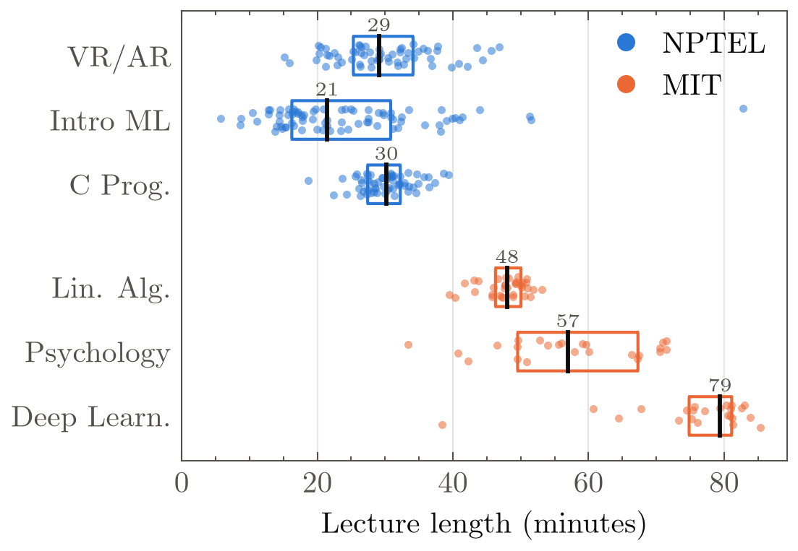
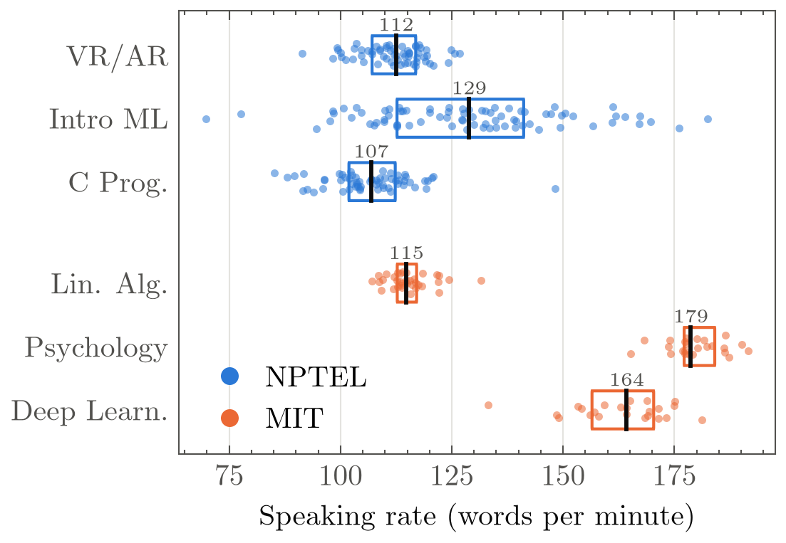
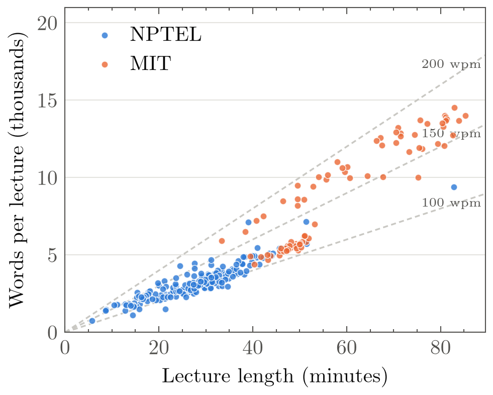
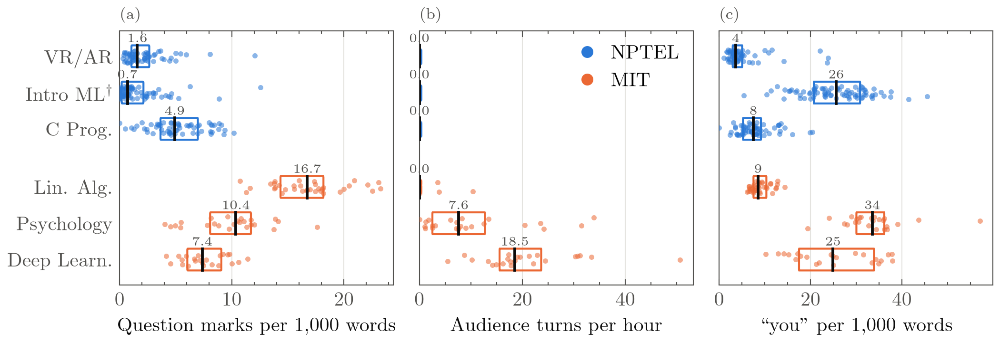
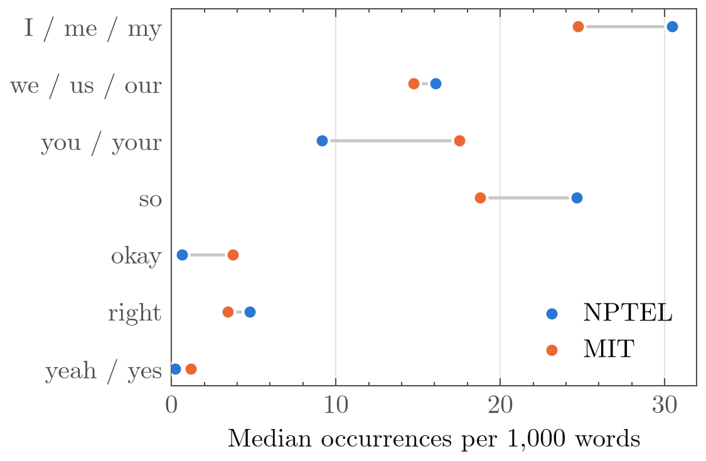
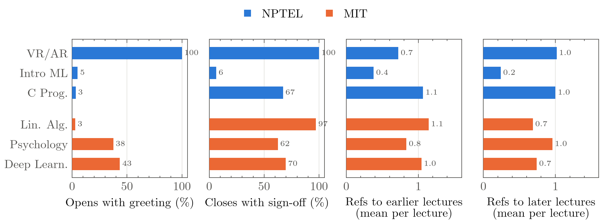
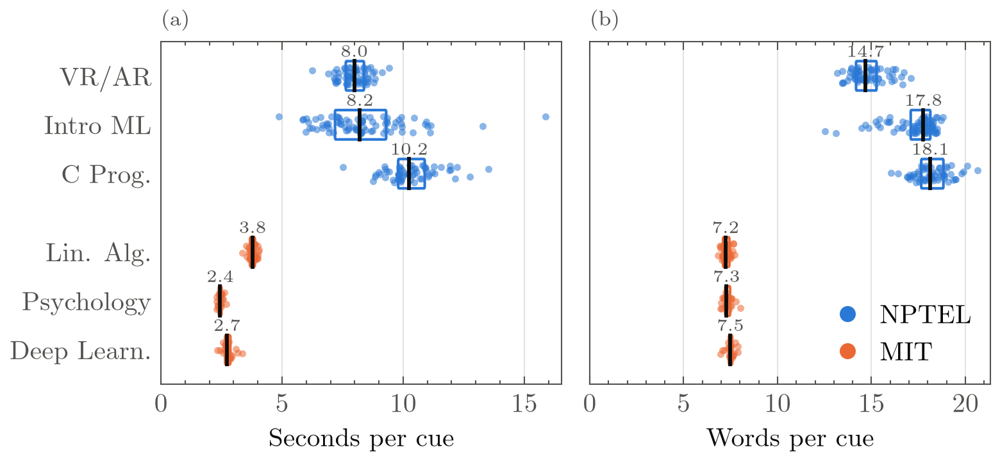

# Dataset characterisation: NPTEL vs MIT lectures

283 lectures in six courses: three NPTEL courses (201 lectures, 93 h) and three MIT OpenCourseWare
courses (82 lectures, 80 h). All statistics are computed from the subtitle text exactly as stored
(cue text only, no index or timestamp lines) and from cue timing. Tutorials are excluded. VR/AR has
61 lectures here because lectures 4 and 5 have no subtitles.

## At a glance

| Course | Provider | Lectures | Hours | Length (min) | Words / lecture | Speaking rate (wpm) | Vocabulary (MATTR) |
|---|---|---:|---:|---:|---:|---:|---:|
| VR/AR | NPTEL | 61 | 30.2 | 29 | 3,186 | 112 | 0.38 |
| Intro ML | NPTEL | 79 | 32.2 | 21 | 2,659 | 129 | 0.34 |
| C Prog. | NPTEL | 61 | 30.6 | 30 | 3,181 | 107 | 0.31 |
| Lin. Alg. | MIT | 35 | 27.8 | 48 | 5,458 | 115 | 0.34 |
| Psychology | MIT | 24 | 22.9 | 57 | 10,269 | 179 | 0.44 |
| Deep Learn. | MIT | 23 | 29.0 | 79 | 12,759 | 164 | 0.40 |
| **NPTEL** | | **201** | **93.1** | **28** | **3,092** | **113** | **0.34** |
| **MIT** | | **82** | **79.7** | **51** | **8,520** | **156** | **0.39** |

Length, words and rate are per-lecture medians. MATTR is the moving-average type–token ratio over a
500-word window, a vocabulary-diversity measure that doesn't depend on text length.

## NPTEL vs MIT, side by side

Lecture-level values are medians (interquartile range); course-level values give the range across the
three courses in each group.

| | NPTEL | MIT |
|---|---|---|
| **Recording setting** | Mixed: studio (VR/AR, C Prog.) and classroom (Intro ML: "any questions" 26×, "in the class" 21×) | Classroom, all three courses |
| **Audience speech in captions** | Never transcribed. 0 speaker labels. Intro ML marks student replies only as `[Student]` / `[student gives answer]` (3×) | Transcribed, with speaker labels: 860 audience/student turns (Deep Learn. 610, Psychology 235, Lin. Alg. 15) |
| **Mode** | One-way: monologue to camera, or a class whose replies go unrecorded | Two-way: questions and answers with the room |
| **Course structure** | Modular: 12 weekly units, 4–13 lectures per week (median 5) | A sequence of class sessions with no weekly units |
| **Lectures per course** | 61–79 | 23–35 |
| **Hours per course** | 30.2–32.2 | 22.9–29.0 |
| **Words per course** | 195k–244k | 193k–283k |
| **Lecture length** | **28 min** (21–32) | **51 min** (48–72) |
| **Words per lecture** | **3.1k** (2.5k–3.7k) | **8.5k** (5.6k–12.2k) |
| **Speaking rate** | 113 wpm (105–125) | 156 wpm (115–176) |
| **Time before first speech** | 11 s; title sequence (24 s in every VR/AR video) | 0 s |
| **Opens with greeting** | 33% of lectures | 24% |
| **Closes with sign-off** | 53% | 79% |
| **References to other lectures** | 0.7 back, 0.7 forward per lecture | 1.0 back, 0.8 forward |
| **Question marks per 1,000 words** | 2.2 | 11.4 |
| **"you" per 1,000 words** | 9 | 18 |
| **Lectures with laughter tags** | 0% | 16% |
| **Vocabulary diversity (MATTR)** | 0.34 | 0.39 |
| **Fillers ("um", "uh")** | 0 (cleaned) | 0 (cleaned) |
| **Caption cue** | 8.5 s, 17 words | 2.9 s, 7 words |
| **Captions** | NPTEL "Verified" or official subtitles | Human-made "English - CC" |

**In short:** an NPTEL course is longer overall (2.5× the lectures and 1.2× the hours on average) but
is cut into short, weekly modules. An MIT course packs a similar total amount of speech, about
190k–280k words per course, into fewer, longer and faster class sessions that include the audience.

## Key findings

**Differences**

- **MIT lectures are about twice as long and have nearly 3× the words.** The median MIT lecture is
  51 min long with 8.5k words; the median NPTEL lecture is 28 min with 3.1k words. NPTEL courses are
  recorded as short modular videos; the MIT videos are full class sessions.
- **MIT speakers talk faster, except in Linear Algebra.** The median rate is 156 wpm for MIT and
  113 wpm for NPTEL. Linear Algebra (115 wpm) sits with NPTEL, because a blackboard lecture is paced
  by the writing.
- **NPTEL lectures are monologues; MIT lectures are classroom exchanges.**
  - Audience turns per hour: NPTEL 0, MIT 3.7 (Deep Learning 18.5).
  - "you" per 1,000 words: NPTEL 9, MIT 18.
  - Question marks per 1,000 words: NPTEL 2.2, MIT 11.4.
  - Laughter tags: in 16% of MIT lectures and none of the NPTEL lectures.
- **The courses frame their lectures differently.**
  - VR/AR opens with a greeting and closes with a sign-off in 100% of lectures, a scripted format.
  - Intro ML does either in only 5–6% of lectures. Its videos are cut from longer recordings and start
    or end mid-topic.
  - MIT lectures usually close with a sign-off (62–97%) but open with a greeting less often (3–43%).
- **NPTEL videos have a title sequence before the speech.** The first cue starts at 11 s (median), and
  at exactly 24 s in every VR/AR video. MIT lectures start speaking at 0 s.
- **The captions are segmented differently.** An NPTEL cue covers 8.5 s and 17 words; an MIT cue
  covers 2.9 s and 7 words. This matters for any model that takes cues as input units.

**Similarities**

- **Vocabulary diversity is close:** MATTR 0.34 for NPTEL and 0.39 for MIT. The spread between courses
  within each provider (0.31–0.44) is larger than the gap between providers.
- **Lectures refer to earlier and later lectures about equally often** in both: about 1 reference
  back and 0.7–1 forward per lecture.
- **Speaking rate is flat across the lecture.** For MIT, the rate in each tenth of a lecture stays
  within ±3% of that lecture's mean. NPTEL is the same in the middle eight tenths. Its first tenth is
  12% slower because of the title sequence. Its last tenth is 9% faster, because length is measured to
  the last cue and so no trailing silence is counted.
- **All captions are cleaned:** "um" and "uh" occur 0 times in every course. The captioners removed
  fillers, so disfluency can't be used as a signal.
- **"we" is used at the same rate** (about 15 per 1,000 words). Both providers talk in the inclusive
  "let's work through this" register.

## Figures

PNG files for viewing, with vector PDF copies alongside in `figures/`.



**Fig. 1 — Lecture length.** Each dot is a lecture; boxes show the interquartile range and the median.
The NPTEL and MIT ranges don't overlap. MIT courses are internally consistent; Intro ML varies most,
from 6 to 83 min.



**Fig. 2 — Speaking rate.** Psychology and Deep Learning are fastest (164–179 wpm). Linear Algebra
matches the NPTEL rates.



**Fig. 3 — Words against lecture length.** Dashed lines mark constant speaking rates. NPTEL lectures
cluster tightly along roughly 110 wpm; MIT lectures split into a slow group (Linear Algebra) and a fast
group (Psychology, Deep Learning).



**Fig. 4 — Signals of two-way interaction.**
(a) Question marks per 1,000 words.
(b) Audience turns per hour, counted from `AUDIENCE:` and `STUDENT(S):` speaker labels.
(c) "you" per 1,000 words.
MIT is higher on all three. † Intro ML captions are lightly punctuated, so its question-mark rate
(a) is underestimated.



**Fig. 5 — Pronouns and discourse markers.** Provider medians per 1,000 words. NPTEL leans on "I" and
"so"; MIT uses more "you", "okay" and "yeah", the vocabulary of talking with a room.



**Fig. 6 — How lectures start and end.** Greeting and sign-off detection uses the first and last 100
words of each lecture. Cross-references are phrases such as "last lecture" and "next class".



**Fig. 7 — Caption segmentation.** (a) Seconds per cue. (b) Words per cue. NPTEL cues are about 2–3×
longer. This comes from the captioning conventions, not from how the lecturers speak.

## Caveats

- **Speaker labels and sound tags are caption conventions.** NPTEL captions never label speakers, so
  "0 audience turns" combines two facts. The studio recordings (VR/AR, C Prog.) have no audience. In
  the classroom-recorded Intro ML the students are there, but their speech is not captioned; it is
  marked at most with a tag such as `[student gives answer]`. Linear Algebra has students in the room, but its captioners labelled them
  only 15 times across 35 lectures. Its interaction shows up instead as the highest question rate in
  the dataset (16.7 per 1,000 words; Strang constantly asks the class).
- **Punctuation-based measures are unreliable for Intro ML.** Its captions average 61 words per
  "sentence", so question marks and sentence lengths are not comparable to the other courses.
- **Lecture length is the end time of the last cue,** which is a close lower bound on the video length.
- **The text includes caption extras** such as speaker labels, `[sound tags]` and the OCW licence
  notice (see `dataset/PREPROCESSING.txt` §7). They make up at most 0.75% of a course's words
  (Psychology 0.70%, Deep Learning 0.75%, Linear Algebra 0.01%).
- **This is one comparison of six courses.** Speaker style varies a lot within each provider (e.g.
  "you" ranges from 4 per 1,000 words in VR/AR to 26 in Intro ML), so provider-level medians describe
  this dataset, not NPTEL or MIT in general.

## Files and reproduction

| File | Contents |
|---|---|
| `lecture_stats.csv` | one row per lecture, with every metric used here (including speaking rate per tenth of the lecture) |
| `figures/` | `fig1`–`fig7` as `.png` (300 dpi) and `.pdf` |
| `compute_stats.py` | builds `lecture_stats.csv` from `dataset/*/subs` |
| `make_figures.py` | draws the figures (matplotlib + SciencePlots `science` style, LaTeX text) |

```
bin/python stats/compute_stats.py
bin/python stats/make_figures.py
```

Run these from the `mtp-implementation` root.
